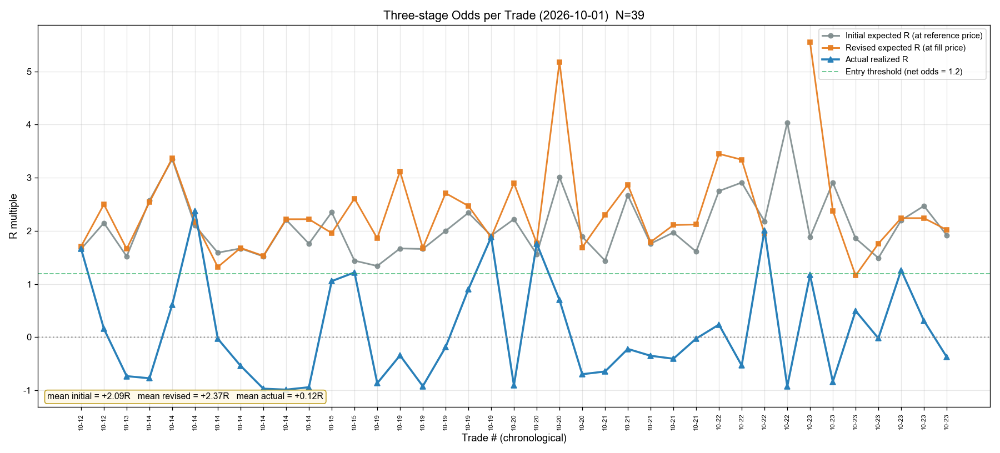

# 美股交易复盘报告 · 全量历史（截至 2026-10-23 ET）

> 复盘日期：2026-10-24｜费率口径：**0.5.0 新口径**（美股三项每笔最低 + 卖侧规费，见 CHANGELOG [0.5.0]）
> 数据源：券商 API（2026-10-14 起）+ actions/ 解析（2026-08-12~10-13）+ 历次复盘 CSV（~2026-08-11）
> 样本：`reviews/2026-10-24-trades-us.csv`（**69 笔**）｜统计脚本：`review.py` / `bayes_evolution.py`（实跑输出，无手算）
>
> ⚠️ **本报告为第二版（数据修正版）**：初版 63 笔的结论有误，修了两处数据缺陷（见「一、样本构成」末段），修正后**全量 EV 从 −0.196R 变为 −0.111R、10 月从 −0.003R 变为 +0.117R**。

---

## 一、样本构成与对账

| 段 | 区间 | 笔数 | 数据源 | 权威性 |
|---|---|---|---|---|
| ① | 2026-07-08 ~ 08-11 | 20 | `reviews/2026-08-13-trades-us.csv` | 历次复盘已整理（signal 模式） |
| ② | 2026-08-28 ~ 10-13 | 13 | `actions/*-ET-actions.md` 解析 | 次级——API 已不返回该段；**11/13 笔通过「文档落地赔率反推 max_loss」自洽校验**（±3%），2 笔偏差 6~14% |
| ③ | 2026-10-14 ~ 10-23 | **36** | 券商 API `get_orders` 配对 | 最高（真实成交价 / realized_pnl / 实测佣金）|

**合计 69 笔**（20 + 13 + 36；10 月 39 笔）。

### ⚠️ 初版的两处数据缺陷与修正（必读）

初版用 63 笔、结论偏负，两处都是**数据层错误**、不是策略判断问题：

1. **API 订单被截断漏了 6 笔**：`get_orders` 默认 `limit=100`，实测 10-14~10-25 窗口 `limit=100` 返回 100 条、`limit=500` 返回 **118 条**——**10-14 的 6 笔 SOXL 交易整批消失**。已修 `stop_summary.fetch_orders()`：显式 `limit=1000` + 命中上限时告警（不再静默截断）。修正后 10 月从 33 笔 → **39 笔**、全量 63 → **69 笔**。
2. **max_loss 用了「移损后」的止损价**：初版 API 段直接取订单的 `stop_leg.aux_price`，而它会被 `move_stop` 改写。实测 `10-14 SOXL 115.495 → 113.86` 那笔被移损到 115.44，max_loss 只剩 **$16.83**（真实约 $200），单笔 R 被算成 **+29R**、把样本标准差 s 从 0.89 拉到 2.70。已修：API 段的原始止损一律从 `actions/` 的**开仓记录**解析（同标的 + 日期 ±1 天 + 成交价 ≤0.6% 匹配），匹配不到才退回 `stop_leg` 并标注。

**两道修正后的最终数字**见下节。这两处也说明：**复盘数据必须做与券商/记录的双向核对**，只看单一来源会把结论带偏。

---

## 二、终局统计（N=69）

| 指标 | 值 |
|---|---|
| 笔数 | 69（37 多 / 32 空）|
| 胜率 | **36.2%**（25 胜 / 44 负）|
| 胜赔率 | +0.882R |
| 败赔率 | −0.675R |
| **EV** | **−0.111R / 笔（−11.1%）** |
| 总净盈亏 | **−$50,979.3** |
| R 样本标准差 s | 0.893 |
| 贝叶斯 P(EV>0) | **15.4%**（σ 不确定 11.5%~19.7%）|
| 频率派 EV 95% CI | [−0.321, +0.100]（跨 0）|

**判读**：EV 点估计为负但**幅度不大（−0.11R）**，且 95% CI 跨 0 —— 69 笔只能确定「方向略偏负」，不能断定未来必然为负。按当前 s=0.893，要做到 ±0.1R 精度需 308 笔；确认「真实 EV=+0.2R」需 123 笔。

---

## 三、分维度拆解（关键）

### 3.1 按阶段：8-9 月是全部亏损来源，10 月已转正

| 月份 | N | 胜率 | EV(R) | 胜赔率 | 败赔率 | 总盈亏 |
|---|---|---|---|---|---|---|
| 2026-07 | 9 | 44.4% | −0.134 | +0.63 | −0.75 | **+$1,589** |
| 2026-08 | 14 | 28.6% | **−0.497** | +0.31 | −0.82 | **−$52,600** |
| 2026-09 | 7 | 14.3% | **−0.580** | +0.47 | −0.75 | −$540 |
| 2026-10 | 39 | 41.0% | **+0.117** | **+1.11** | −0.58 | **+$572** |

月度 EV：−0.134 → −0.497 → −0.580 → **+0.117**。**10 月是本样本里唯一正 EV 的月份**，胜赔率从 0.31（8 月）翻到 1.11 是主因。

### 3.2 分界线两侧（红线位置，见第四节图）

| 区间 | N | 胜率 | EV(R) | 胜赔率 | 败赔率 | 总盈亏 |
|---|---|---|---|---|---|---|
| 线左 07-08~09-16 | 30 | **30.0%** | **−0.407** | +0.47 | −0.78 | **−$51,551** |
| 线右 10-12~10-23 | 39 | **41.0%** | **+0.117** | **+1.11** | −0.58 | **+$572** |

### 3.3 按模式：auto 已接近打平

| 模式 | N | 胜率 | EV(R) | 胜赔率 | 败赔率 | 总盈亏 |
|---|---|---|---|---|---|---|
| signal（07-08~08-11）| 20 | 35.0% | **−0.311** | +0.53 | −0.77 | −$32,416 |
| auto_paper（08-28~10-23）| 49 | 36.7% | **−0.029** | **+1.02** | −0.64 | −$18,563 |

auto 模式胜赔率翻倍（0.53 → 1.02）、EV 改善 0.28R/笔、**已基本是零期望**。注意两段不同期、混有市场环境差异，不能简单归因于模式切换。

### 3.4 按方向：空单赔率略优、胜率同样不足

| 方向 | N | 胜率 | EV(R) | 胜赔率 | 败赔率 | 盈亏平衡所需胜率 |
|---|---|---|---|---|---|---|
| 多 | 37 | 37.8% | −0.102 | +0.81 | −0.66 | 44.9% |
| 空 | 32 | 34.4% | −0.121 | +0.97 | −0.69 | 41.6% |

两个方向都是「胜率差 4-8pp → EV 为负」，**空单赔率结构（0.97 vs 0.81）略好于多单**，弥补了一部分胜率劣势。

### 3.5 按标的（N≥3）

| 标的 | N | 胜率 | EV(R) | 胜赔率 | 败赔率 | 总盈亏 |
|---|---|---|---|---|---|---|
| US.SOXL | 25 | 28.0% | −0.089 | **+1.35** | −0.65 | −$297 |
| US.MU | 10 | 40.0% | **−0.273** | **+0.55** | −0.82 | **−$21,418** |
| US.META | 5 | 60.0% | **+0.536** | +1.20 | −0.45 | +$225 |
| US.LITE | 4 | 75.0% | **+0.382** | +0.65 | −0.43 | −$2,826 |
| US.NVDA | 3 | 33.3% | −0.321 | +1.05 | −1.00 | −$5,215 |
| US.QQQ | 3 | 66.7% | +0.350 | +0.83 | −0.62 | +$23 |
| US.TQQQ | 3 | 33.3% | −0.220 | +0.47 | −0.56 | −$78 |
| US.GOOG | 3 | 0.0% | −0.325 | — | −0.33 | −$77 |

**SOXL 是主战场（25/69 笔）且赔率结构最好（1.35）**，只差胜率（28%，需 32.5% 才打平）；**MU 是最差结构（胜赔率 0.55，需胜率 61%、实际 40%）**，10 笔亏掉 $21,418，是仅次于 8 月大单的第二大失血点。

### 3.6 亏损结构

**最大 6 笔亏损合计 −$53,631 = 全部亏损（−$58,920）的 91.0%**

| 日期 | 标的 | 净盈亏 | R | 净 max_loss |
|---|---|---|---|---|
| 08-28 | US.CRM | −$13,553 | −1.00 | $13,554 |
| 08-11 | US.MU | −$12,982 | −0.87 | $14,911 |
| 08-11 | US.MU | −$9,644 | −0.94 | $10,243 |
| 08-07 | US.AAOI | −$7,464 | −0.47 | $16,010 |
| 08-28 | US.NVDA | −$5,146 | −0.98 | $5,253 |
| 08-10 | US.LITE | −$4,843 | −0.43 | $11,278 |

**剔除这 6 笔后：其余 63 笔合计 +$2,652、EV −0.047R**（接近打平）。
剔除最大 10 笔亏损后：59 笔合计 +$4,233、**EV +0.011R**。

**结论：美股历史亏损不是「每笔都小亏」的累积，而是少数大仓位失败单的集中打击。** 这 6 笔全部发生在 8 月及之前，单笔净 max_loss $5,253~$16,010（当时模拟盘未受购买力限制）。

### 3.7 仓位规模对比

| 分组 | N | 胜率 | EV(R) | 胜赔率 | 总盈亏 |
|---|---|---|---|---|---|
| 净 M ≥ 500（大仓位）| 14 | 50.0% | −0.186 | +0.39 | **−$49,750** |
| 净 M < 500（小仓位）| 55 | 32.7% | −0.092 | **+1.07** | −$1,229 |

大仓位胜率更高（50% vs 32.7%）但**胜赔率只有 0.39**（赢的时候赚太少），且总亏损 99.6% 集中在这 14 笔。小仓位胜赔率 1.07 是健康结构、EV 也更好（−0.092 vs −0.186）。

### 3.8 费率影响（新口径实算）

- 费占净 M：中位数 **3.0%**，最大 31.5%
- ≥6% 的 19 笔：EV **−0.014R**；<6% 的 50 笔：EV **−0.147R**

**费率高的组 EV 反而更好**——在这批样本里费用不是亏损主因（且方向与直觉相反，很可能只是噪声或与仓位/标的的混杂）。费率修正的价值在于**让赔率算准、不把不达标单放行**。

---

## 四、序贯演化图（全量 7 张，随报告展示）

> 生成命令：`bayes_evolution.py --date 2026-10-24 --suffix -us --vline-date 2026-10-01`，横轴为累计交易笔数（N=1~69）。图内数值与第二节一致。
>
> **🔴 红色垂直虚线 = 期间分界线（2026-10 起，第 31 笔）**：线左侧 30 笔（07-08~09-16），线右侧 39 笔（10-12~10-23）。两侧对比见 3.2 节——**线左 EV −0.407R、线右 +0.117R**，图上红线两侧的斜率反转是本场复盘最直观的结论。

### 4.1 贝叶斯 P(EV>0) 演化（NIG t 后验）

随 N 累积，P(EV>0) 在 8-9 月那段被压到很低，10 月后回升，**终局 15.4%**（σ 不确定 11.5%~19.7%）。这个收敛形态说明样本量只够看方向、不够定量。

### 4.2 累计 EV 演化（均值 R ± 频率派 95% CI）

累计 EV 从早期正值区下探到 8-9 月的低点（约 −0.41R），10 月后一路回升到 **−0.111R**。**CI 带始终跨越 0 线**，是「不能断定未来必负」的图形化依据。

看红线两侧：线前探到 −0.407R（最低点），线后 39 笔把均值拉回 −0.111R——**改善幅度 0.29R 是本样本最重要的变化**，但还没能把全量 EV 推过 0。

### 4.3 贝叶斯胜率演化（Beta(1,1) 先验）

胜率收敛到 **36.2%**。线左（30 笔）只有 **30.0%**（8-9 月连败压低），线右（39 笔）回升到 **41.0%**——贝叶斯后验均值在红线后明显上挑，但仍未回到 50%。

### 4.4 按风险比例 f 的 P(g>0) 演化

五个 f 档同步下沉。终局 f=2% 时 **P(g>0)=13.5%**；f 越大衰减越快——**负 EV 下加大下注比例只会加速归零**（几何增长率框架的直接体现）。

### 4.5 P(∑40 笔 ≥ 0) 演化

未来 40 笔累计不亏的概率，终局 f=2% 时 **25.2%**。

### 4.6 P(g ≥ ln(1.2)/40) 演化（达成 20% 年化所需单笔增速）

⚠️ 这是**期望口径**（把 40 笔随机路径压成长期均值 g 折算门槛），**丢路径方差、系统性偏高**。「40 笔达 20% 的概率」以 4.7 为准。终局 f=2% 仅 0.1%。

### 4.7 P(∑40 笔 ≥ ln(1.2)) 演化（40 笔累计 ≥ +20%）

终局 f=2% 为 **2.7%**。与目标 20% 累计收益的差距，是这份复盘最直白的结论。

---

## 五、10 月子集演化图（只看 2026-10-12~10-23，N=39）

> 生成命令：`bayes_evolution.py --date 2026-10-24 --suffix -us --since 2026-10-01`（图名带 `-from-2026-10-01`、不覆盖全量图）。
> **为什么单独画**：全量 69 笔里 30 笔来自 7-9 月（重灾区），会把 10 月表现掩盖——单独看 10 月才能判断「当前这套做法现在是否成立」。

**与全量对比**

| 指标 | 全量 N=69 | **10 月 N=39** | 变化 |
|---|---|---|---|
| 胜率 | 36.2% | **41.0%** | +4.8pp |
| 胜赔率 | +0.882R | **+1.113R** | +0.231R |
| 败赔率 | −0.675R | **−0.575R** | +0.100R |
| **EV** | −0.111R | **+0.117R** | **+0.228R** |
| 总净盈亏 | −$50,979 | **+$572** | 转正 |
| **贝叶斯 P(EV>0)** | 15.4% | **77.1%** | +61.7pp |
| EV 95% CI | [−0.321, +0.100] | [−0.189, +0.424] | — |
| s（R 标准差） | 0.893 | 0.977 | 略增 |

**关键判读**：只看 10 月，**EV = +0.117R、P(EV>0) = 77.1%**——这是**统计上偏正期望**的信号。但 **39 笔的 95% CI 是 [−0.189, +0.424] 仍然跨 0**，且 77.1% 离 95% 确认线还有距离：**方向值得乐观、尚不可当结论**（按当前 s，确认「真实 EV=+0.2R」需 123 笔，10 月口径还差 84 笔）。

### 5.1 贝叶斯 P(EV>0) 演化

在 30%~83% 之间大幅震荡、**终局 77.1%**，与全量图（15.4%、贴地）形成鲜明对比。

### 5.2 累计 EV 演化

累计 EV 在 0 附近上下震荡、**终局 +0.117R**；CI 带较宽（±0.31），前期因样本少更宽。

### 5.3 贝叶斯胜率演化

胜率后验从 33% 起步、震荡上行到 **41.0%**，仍未达多空平衡所需的 44-46%。

### 5.4 P(g>0) 演化（多 f）

终局 f=2% 时 **75.5%**（σ 不确定 71%~80%），f 越大越低——与全量图 13.5% 天差地别。

### 5.5 P(∑40≥0) 演化（多 f）

终局 f=2% 时 **68.9%**：接下来 40 笔累计不亏的概率接近七成。

### 5.6 P(g≥ln1.2/40) 演化（多 f）

期望口径、丢路径方差（「40 笔达 20%」以 5.7 为准）。终局 f=2% 为 22.2%。

### 5.7 P(∑40≥ln1.2) 演化（多 f）

终局 f=2% 为 **29.3%**——比全量的 2.7% 高了十倍以上。

**本节小结**：7 张图都只含 39 个点，**去掉了左侧 30 笔的历史包袱后曲线明显健康**：P(EV>0) 在 30%~83% 震荡（不是全量图的一路贴地）、EV 在 0 附近（不是一路 −0.4R）、P(g>0) 75.5%（不是 13.5%）。这确认了「历史负 EV 主要来自 7-9 月」。

---

## 六、三阶段赔率逐笔折线图（10 月，N=39）

> 生成命令：`r_phases_chart.py --csv reviews/2026-10-24-trades-us.csv --since 2026-10-01 --out reviews/2026-10-24-us-from-2026-10-01-rphases.png`（2026-10-24 用户立）
> 口径：**初始预期 R / 修正预期 R** 取自 `actions/` 开仓记录（开仓当时脚本实算并落盘，含降档后真实费）；**实际落地 R** 用 csv + `fee_schedule` 按 review.py 同口径**实算**，不抄手写值。39 笔全部配对成功（零未匹配）。

**三条线的含义**

- 🟤 **灰线 = 初始预期 R**（按参考价算的开仓前预估）
- 🟠 **橙线 = 修正预期 R**（按实际成交价 + 原始止损重算）
- 🔵 **蓝线 = 实际落地 R**（平仓后的净 R）
- 🟢 绿色虚线 = 开仓门槛 1.2；灰色点线 = 0（盈亏平衡）

**核心发现：预期与现实的断层**

| 阶段 | 39 笔均值 | 说明 |
|---|---|---|
| 初始预期 R | **+2.09R** | 开仓时预估的赔率 |
| 修正预期 R | **+2.37R** | 按成交价重算，比初始更高 |
| **实际落地 R** | **+0.12R** | 真实拿到的 |

**预估兑现率 ≈ 5%**（0.12 ÷ 2.37）。这张图把「赔率三阶段系统性打折」从概念变成了可视证据：

1. **修正 > 初始是正常的**（成交价常优于参考价），但两者都稳定在 1.2~5.2R 的高位；
2. **实际落地几乎全程贴着 0 线**，且有大段区间在 −1R 附近（止损被扫）；
3. 全图只有少数几笔蓝色尖峰穿过 1.2 门槛（第 4 笔 +2.37R、第 24 笔 +2.0R 等）——**赚钱笔少而尖，亏钱笔多而平**，这正是胜率 41% + 败赔率 −0.58 结构下的必然形态。

**这张图给出的改进指向**：问题不在「开仓时赔率估得太乐观」（初始与修正接近，预估本身是自洽的），而在**「赔付能不能兑现」**——止盈目标是否可达、止损是否过早被扫。这与 3.6 节的发现（亏损集中在少数大仓位单）互补：**大仓位单把「不兑现」放大成了巨额亏损**。

---

## 七、数据质量局限（必须如实标注）

1. **本报告已是第二版**：初版的 API 截断（漏 6 笔）与移损止损（max_loss 低估）两处缺陷已修，详见第一节末段。**凡引用本复盘结论，请确认看到的是第二版（69 笔）**。
2. **9 笔 R 超出合理区间（|R|>1.05）**：如 `10-19 SOXL 空 +4.32R`（推算止损距仅 0.34%）、`10-21 GOOG −1.12R`、`10-22 META −1.14R`——说明这些笔记录的原始止损与真实止损仍有偏差。已保留原记录值、未擅自修改，待券商账单复核。
3. **过程指标（MAE / MFE / 回吐 / 锁利效率 η）全缺**：CSV 无 `raw_high` / `raw_low`，要补需按开平仓时间戳回拉富途分钟 K。
4. **第 ② 段 13 笔中 2 笔自洽校验偏差 6~14%**（09-11 QQQ、09-14 TSLA）：疑移损后止损被当作原始止损记录。
5. **熔断判据不动用本报告**：项目熔断机制固定用「全体真实样本」（当前 N=87 港股为主），本报告是**美股子集**，两者不可混用。

---

## 八、结论与建议（均标注统计依据强度）

### 结论

1. **全量 69 笔 EV = −0.111R、P(EV>0) = 15.4%、CI 跨 0**——目前证据不足以说美股「能稳定盈利」，但**也不是显著负期望**（点估计幅度小、区间宽）。
2. **10 月单独看是正期望**：39 笔 EV **+0.117R**、P(EV>0) **77.1%**，是全样本唯一正 EV 的月份。但 CI 仍跨 0（[−0.189, +0.424]）、39 笔不足定论。
3. **亏损高度集中**：最大 6 笔占全部亏损 91%，全部是 8 月及之前的大仓位单；剔除后 63 笔 EV −0.047R、总盈亏转正（+$2,652）。
4. **大仓位的结构问题不是胜率而是赔率**：净 M ≥500 的 14 笔胜率 50%（比小仓位的 32.7% 高），但胜赔率只有 0.39——**赢的时候赚太少、输的时候亏太多**，这才是 8 月巨亏的机制。
5. **三阶段赔率断层**：预期 2.09~2.37R、实际 0.12R，兑现率约 5%——改善重点在「赔付兑现」而非「赔率预估」。
6. **MU 是最差结构**（胜赔率 0.55、10 笔亏 $21,418），**SOXL 是主战场且赔率最好**（25 笔、胜赔率 1.35，只差胜率）。

### 建议（按证据强度）

**A 级（有统计支撑）**
1. **继续保持当前小仓位（净 M $10~300）**：小仓位组胜赔率 1.07、EV −0.092，明显优于大仓位组（胜赔率 0.39、EV −0.186）。**不要为了「提高收益」放开购买力限制**——历史上放开的那段时间贡献了全部亏损。
2. **MU 类「胜赔率 <0.7」标的先修止盈/止损结构再用**：MU 10 笔胜赔率 0.55（需胜率 61%、实际 40%），是唯一「方向对也赚不到钱」的结构性缺陷。
3. **大仓位单必须逐笔过全流程自查**：6 笔巨额亏损全部来自未受约束的大仓位。

**B 级（假设，需更大样本）**
4. **10 月的正 EV 需要继续验证**：按当前 s=0.977，确认「真实 EV=+0.2R」需 123 笔（现 39 笔）。建议保持现状再跑 40-80 笔，届时重跑本复盘看 P(EV>0) 是否站上 95%。
5. **赔付兑现率（5%）需要按止盈可达性统计**：可把 39 笔按「止盈是否越过当日高/低点」分组，看兑现率与止盈距离的关系。

**不建议做的事**
- 因 10 月正 EV 就认为「策略已经修好」——39 笔、CI 跨 0。
- 把本报告与港股样本（+0.097R）直接比较或加权。

---

## 九、配套产物

| 文件 | 说明 |
|---|---|
| `reviews/2026-10-24-trades-us.csv` | **69 笔**全量样本（review.py 口径）|
| `reviews/2026-10-24-us-bayes-evolution.png` 等 7 张 | 全量演化图（含 10 月红线，见第四节）|
| `reviews/2026-10-24-us-from-2026-10-01-*-evolution.png` 等 7 张 | 10 月子集演化图（39 笔，见第五节）|
| `reviews/2026-10-24-us-from-2026-10-01-rphases.png` | 10 月三阶段赔率逐笔折线图（见第六节）|
| `tmp/build_us_trades.py` | 数据构建脚本（三层合并 + 原始止损从 actions 取 + 自洽校验）|
| `scripts/r_phases_chart.py` | 三阶段赔率图脚本（可复用：`--csv --market --since --until --out`）|
