# 美股交易复盘报告 · 全量历史（截至 2026-10-23 ET）

> 复盘日期：2026-10-24｜费率口径：**0.5.0 新口径**（美股三项每笔最低 + 卖侧规费，见 CHANGELOG [0.5.0]）
> 数据源：券商 API（2026-10-14 起）+ actions/ 解析（2026-08-12~10-13）+ 历次复盘 CSV（~2026-08-11）
> 样本：`reviews/2026-10-24-trades-us.csv`（63 笔）｜统计脚本：`review.py` / `bayes_evolution.py`（均为实跑输出，无手算）

---

## 一、样本构成与对账

| 段 | 区间 | 笔数 | 数据源 | 权威性 |
|---|---|---|---|---|
| ① | 2026-07-08 ~ 08-11 | 20 | `reviews/2026-08-13-trades-us.csv` | 历次复盘已整理（signal 模式） |
| ② | 2026-08-28 ~ 10-13 | 13 | `actions/*-ET-actions.md` 解析 | 次级——API 已不返回该段；**11/13 笔通过「文档落地赔率反推 max_loss」自洽校验**（±3%），2 笔偏差 6~14%（见「数据质量局限」） |
| ③ | 2026-10-14 ~ 10-23 | 30 | 券商 API `get_orders` 配对 | 最高（真实成交价 / realized_pnl / 实测佣金） |

**遗漏核查**：09-10 SOXL 在 actions 中有两条完全相同的平仓记录（163 / 181 行），已按一笔计；SNDK / SKHY 平仓无对应开仓属影子仓（纸面样本，不计入真实统计）；10-14 段 6 笔 actions 开仓记录字段不全，但该段已由 API 权威覆盖，不重复计。

---

## 二、终局统计（N=63）

| 指标 | 值 |
|---|---|
| 笔数 | 63 |
| 胜率 | **36.5%**（23 胜 / 40 负）|
| 胜赔率 | +0.911R |
| 败赔率 | −0.832R |
| **EV** | **−0.196R / 笔（−19.6%）** |
| 总净盈亏 | **−$51,094.7** |
| R 样本标准差 s | 1.019 |
| 贝叶斯 P(EV>0) | **6.6%**（σ 不确定 3.8%~10.7%）|
| 频率派 EV 95% CI | [−0.447, +0.056]（跨 0）|

**判读**：EV 点估计显著为负，但 95% CI 跨过 0——**样本量 63 只能确定「方向偏负」，不能断定未来必然为负**（点值与区间都要看，后者反映不确定性）。按当前 s=1.019，要做到 ±0.1R 精度需 399 笔；确认「真实 EV=+0.2R」需 161 笔。

---

## 三、分维度拆解（关键）

### 3.1 按阶段：8 月最差，10 月已回到打平

| 月份 | N | 胜率 | EV(R) | 总盈亏 |
|---|---|---|---|---|
| 2026-07 | 9 | 44.4% | −0.134 | **+$1,589** |
| 2026-08 | 14 | 28.6% | **−0.497** | **−$52,600** |
| 2026-09 | 7 | 14.3% | **−0.580** | −$540 |
| 2026-10 | 33 | 42.4% | **−0.003** | **+$457** |

月度 EV 从 −0.50 / −0.58 收敛到 −0.003，**是明确改善趋势**（8-9 月是重灾区）。

### 3.2 按模式：auto 明显优于 signal

| 模式 | N | 胜率 | EV(R) | 胜赔率 |
|---|---|---|---|---|
| signal（07-08~08-11）| 20 | 35.0% | **−0.311** | +0.53 |
| auto_paper（08-28~10-23）| 43 | 37.2% | **−0.142** | **+1.08** |

auto 模式胜赔率翻倍（0.53 → 1.08），EV 改善 0.17R/笔。**注意**：两段不是同一时期，混有市场环境差异，不能简单归因于模式切换。

### 3.3 按方向：空单赔率高但胜率不足

| 方向 | N | 胜率 | EV(R) | 胜赔率 | 败赔率 | 盈亏平衡所需胜率 |
|---|---|---|---|---|---|---|
| 多 | 34 | 41.2% | −0.159 | +0.78 | −0.82 | 51.3% |
| 空 | 29 | 31.0% | −0.239 | +1.11 | −0.85 | 43.4% |

**空单赔率结构更好（1.11 vs 0.78），但胜率只有 31%、远低于所需的 43.4%**——空单的问题是打不准，不是赔率不够。

### 3.4 按标的（N≥3）

| 标的 | N | 胜率 | EV(R) | 胜赔率 | 备注 |
|---|---|---|---|---|---|
| US.SOXL | 19 | 26.3% | −0.124 | **+1.79** | 高赔率低胜率；盈亏平衡需 31.2%，实际 26.3% |
| US.MU | 10 | 40.0% | **−0.273** | **+0.55** | 胜时赚太少（胜赔率 0.55 明显偏低）|
| US.META | 5 | 60.0% | **+0.177** | +1.01 | 唯一稳定正期望（n=5，不足以定论）|
| US.LITE | 4 | 75.0% | **+0.382** | +0.65 | 同上，n=4 |
| US.NVDA | 3 | 33.3% | −0.321 | +1.05 | |
| US.QQQ | 3 | 66.7% | +0.239 | +0.67 | n=3 |
| US.TQQQ | 3 | 33.3% | −0.459 | +0.47 | 赔率与胜率双低 |
| US.GOOG | 3 | 0.0% | −0.983 | — | 3 笔全败 |

### 3.5 亏损结构（本报告最重要的发现）

**亏损最大的 6 笔合计 −$53,631，占全部亏损（−$58,410）的 92%**：

| 日期 | 标的 | 净盈亏 | R | 净 max_loss |
|---|---|---|---|---|
| 08-28 | US.CRM | −$13,553.5 | −1.00 | $13,554 |
| 08-11 | US.MU | −$12,981.9 | −0.87 | $14,911 |
| 08-11 | US.MU | −$9,644.4 | −0.94 | $10,243 |
| 08-07 | US.AAOI | −$7,463.6 | −0.47 | $16,010 |
| 08-28 | US.NVDA | −$5,145.7 | −0.98 | $5,253 |
| 08-10 | US.LITE | −$4,842.6 | −0.43 | $11,278 |

**剔除这 6 笔后，其余 57 笔合计 +$2,536.8（转正）、EV −0.134R。**

这 6 笔的共同特征：**都发生在 8 月及之前，单笔净 max_loss 高达 $5,253~$16,010**（当时模拟盘未受购买力限制、仓位大）。10 月之后仓位被压到净 M $10~300，单笔失败只损失几十到几百美元。

**结论：美股历史亏损不是「每笔都小亏」的累积，而是 6 笔大仓位失败单的集中打击。** 剔除后策略本身接近打平（EV −0.134R，仍未正）。

### 3.6 仓位规模对比

| 分组 | N | 胜率 | EV(R) | 总盈亏 |
|---|---|---|---|---|
| 净 M ≥ 500（大仓位）| 14 | 50.0% | −0.186 | **−$49,750** |
| 净 M < 500（小仓位）| 49 | 32.7% | −0.198 | −$1,345 |

大仓位胜率更高（50% vs 32.7%）但**总亏损全在大仓位**——因为单笔金额大 20~100 倍。EV 两者几乎相同（−0.186 vs −0.198）。

### 3.7 费率影响（新口径下的实算）

- 费占净 M 中位数 **3.6%**，最大 **59.7%**（极小仓位单）
- 费占净 M ≥6% 的 22 笔：胜率 36%、EV −0.169R
- 费占净 M <6% 的 41 笔：胜率 37%、EV −0.210R

**费率高的组 EV 反而略好**——说明在这批样本里，**费用不是亏损主因**（EV 差 0.04R，且方向与预期相反，很可能只是噪声）。费率修正的真正价值在于**让赔率计算变准、避免把不达标的单放行**（详见 CHANGELOG [0.5.0]），而不是「省下费用就能盈利」。

---

## 四、序贯演化图（全量 7 张，随报告展示）

> 以下图均由 `bayes_evolution.py --date 2026-10-24 --suffix -us --vline-date 2026-10-01` 生成，横轴为累计交易笔数（N=1~63）。图内数值与上文「终局统计」一致。
>
> **🔴 红色垂直虚线 = 期间分界线（2026-10 起，第 31 笔）**：线左侧 = 2026-07-08~09-16 的 **30 笔**，线右侧 = 2026-10-12~10-23 的 **33 笔**。线两侧的量化对比（实算）：
>
> | 区间 | N | 胜率 | EV(R) | 胜赔率 | 败赔率 | 总盈亏 |
> |---|---|---|---|---|---|---|
> | 线左（07-08~09-16）| 30 | **30.0%** | **−0.407** | +0.47 | −0.78 | **−$51,551.3** |
> | 线右（10-12~10-23）| 33 | **42.4%** | **−0.003** | **+1.19** | −0.89 | **+$456.6** |
>
> 分界线左侧累计 EV 从 +0.08 一路下探到 **−0.407R**（图上最低点就在线前），线右侧 33 笔把它拉回 **−0.196R**——**图上红线两侧的斜率差异 = 本场复盘最直观的结论**：策略在 10 月从「大规模失血」转为「接近打平」，胜赔率从 0.47 翻到 1.19 是主要改善来源。

### 4.1 贝叶斯 P(EV>0) 演化（NIG t 后验）

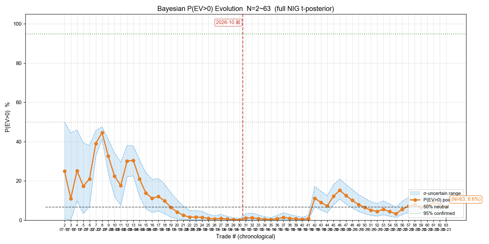

随 N 累积，P(EV>0) 逐步下沉并稳定在 **6.6%** 附近（σ 不确定 3.8%~10.7%）。曲线早期波动大（N<20 时经历多次上下），N>40 后趋稳——这个收敛形态本身就是「样本量够看方向、不够定量」的证据。

### 4.2 累计 EV 演化（均值 R ± 频率派 95% CI）

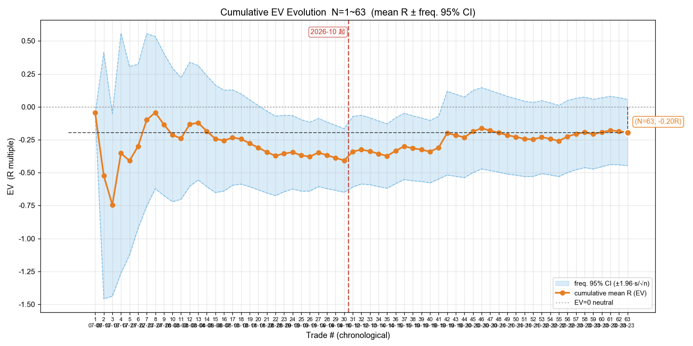

累计 EV 从早期正值区一路下探到 **−0.196R**，8~9 月那段斜率最陡（对应两个月的 −0.497 / −0.580），10 月后曲线基本走平（33 笔 −0.003R）。**CI 带始终跨越 0 线**，是「不能断定未来必负」的图形化依据。

看红线两侧：线前累计 EV 探到 **−0.407R**（最低点），线后 33 笔把均值拉回 −0.196R——**改善是真实的，但回升幅度还不足以把 EV 推过 0**（还需更多 10 月级别的正向样本，见「样本量规划」）。

### 4.3 贝叶斯胜率演化（Beta(1,1) 先验）

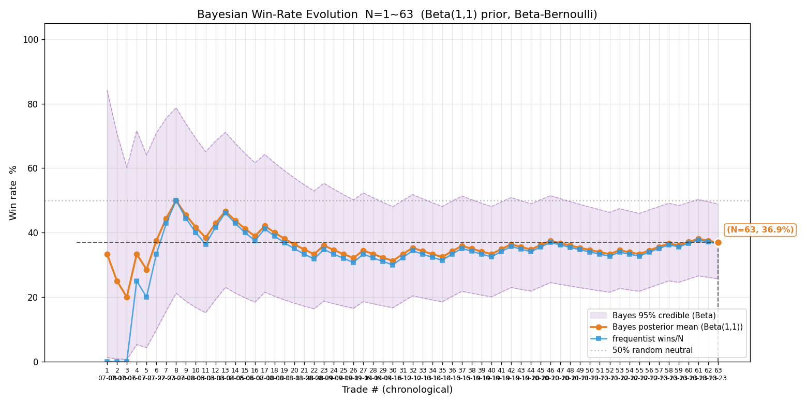

胜率收敛到 **36.5%**。线左（30 笔）实际胜率只有 **30.0%**（8-9 月连败把它压下去），线右（33 笔）回升到 **42.4%**——贝叶斯后验均值在红线后开始轻步上挑，但仍未回到 50% 中性线。

### 4.4 按风险比例 f 的 P(g>0) 演化

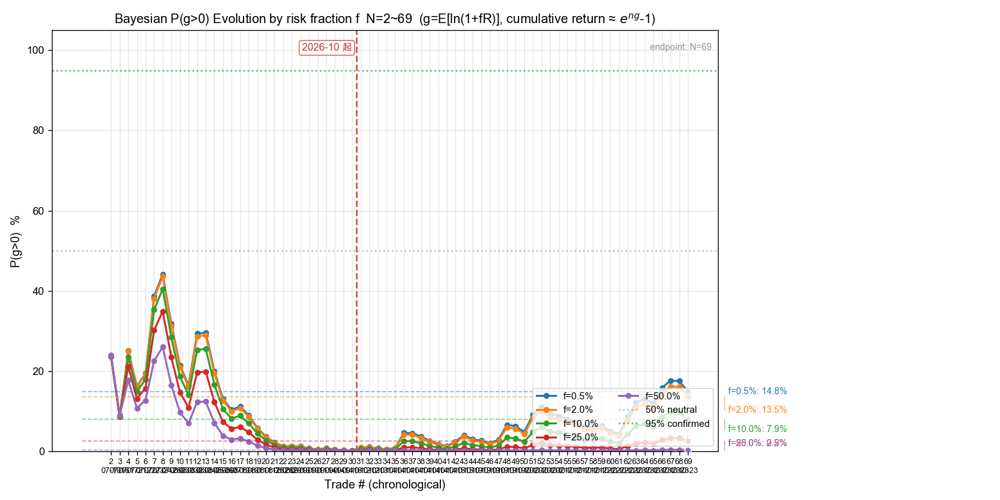

五个 f 档（0.5% / 2% / 10% / 25% / 50%）同步下沉。终局 f=2% 时 **P(g>0)=5.5%**；f 越大衰减越快（f=25% 仅 0.5%、f=50% =0.0%）——**负 EV 下加大下注比例只会加速归零**，这是几何增长率框架的直接体现。

红线两侧的分水岭很清楚：线前概率从 20~40% 一路塔到 **~1%**（8-9 月连败 + 大亏单所致），线后回升到 **5~6%**——方向正确，但离 50%（中性）与 95%（确认线）还差很远。

### 4.5 P(∑40 笔 ≥ 0) 演化

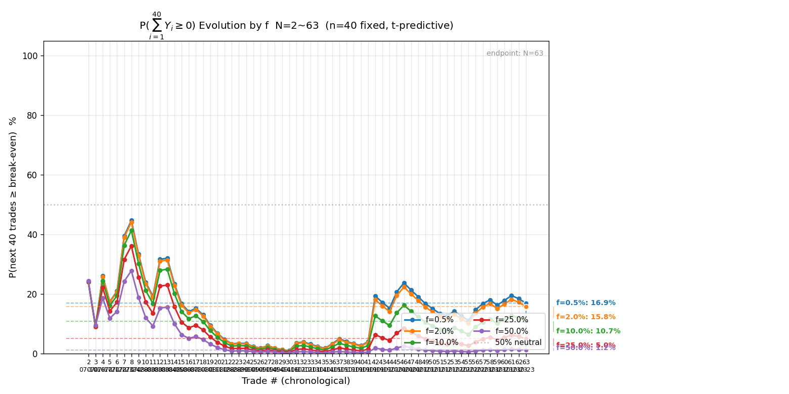

未来 40 笔累计不亏的概率。终局 f=2% 时仅 **15.8%**——即使在当前的「接近打平」阶段，连跑 40 笔仍大概率累计为负。

### 4.6 P(g ≥ ln(1.2)/40) 演化（达成 20% 年化所需单笔增速）

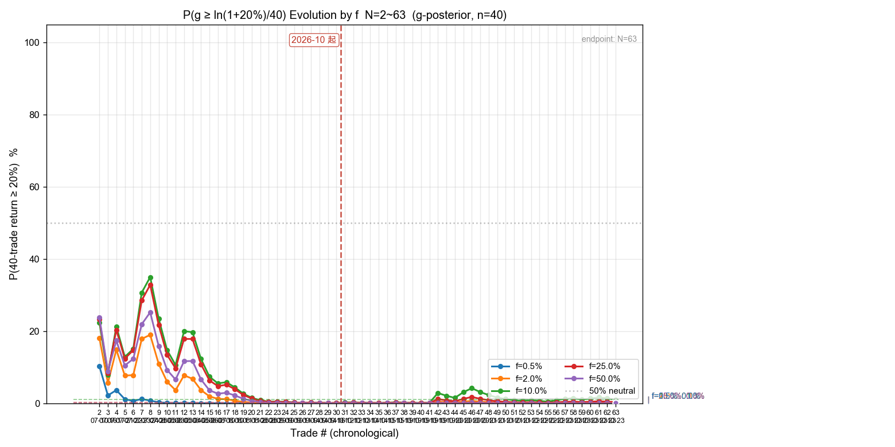

把「40 笔内累计 +20%」拆解成单笔所需增速后，能给到这个增速的概率。终局 f=2% 仅 **0.1%**——现阶段的期望增长率离这个目标差了两个数量级。

### 4.7 P(∑40 笔 ≥ ln(1.2)) 演化（40 笔累计 ≥ +20%）

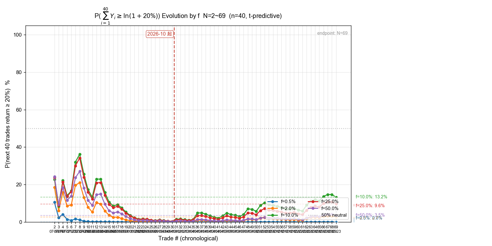

终局 f=2% 为 **1.8%**（f=10% 时 7.1%，因为按比例放大波动也在放大）。与目标 20% 累计收益的差距，是这份复盘最直白的结论。

---

---

## 五、10 月子集演化图（只看 2026-10-12~10-23，N=33）

> 生成命令：`bayes_evolution.py --date 2026-10-24 --suffix -us --since 2026-10-01`（`--since` 过滤后只画该区间的样本，图文件名带 `-from-2026-10-01` 段、不覆盖全量图）。
> **为什么单独画一版**：全量 63 笔里 30 笔来自 7-9 月（重灾区），会把 10 月的表现完全掩盖——单独看 10 月才能判断「当前这套做法现在是否成立」。

**与全量对比（同一套费率口径，实算）**

| 指标 | 全量 N=63 | **10 月子集 N=33** | 变化 |
|---|---|---|---|
| 胜率 | 36.5% | **42.4%** | +5.9pp |
| 胜赔率 | +0.911R | **+1.195R** | +0.284R |
| 败赔率 | −0.832R | −0.885R | −0.053R |
| **EV** | −0.196R | **−0.003R** | **+0.193R** |
| 总净盈亏 | −$51,094.7 | **+$456.6** | 转正 |
| **贝叶斯 P(EV>0)** | 6.6% | **49.5%** | +42.9pp |
| EV 95% CI | [−0.447, +0.056] | [−0.423, +0.418] | 更宽（样本少） |
| s（R 标准差） | 1.019 | 1.233 | 波动更大 |

**关键判读**：只看 10 月，**EV 是 −0.003R、P(EV>0) 49.5%——数学上等价于「零期望 / 抛硬币」**。这不是「已经盈利」，而是「不再是 8-9 月那种系统性失血」。同时 CI 极宽（±0.42R）、s 更大（1.233），33 笔远不足以确认方向——按当前 s，要确认「真实 EV=+0.2R」需 235 笔（全量口径是 161 笔，因为 10 月波动更大）。

### 5.1 贝叶斯 P(EV>0) 演化

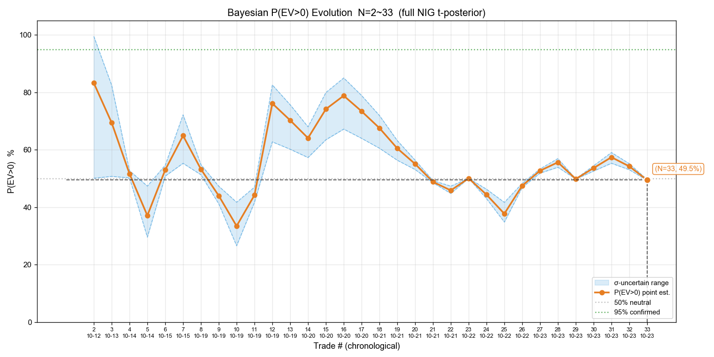

### 5.2 累计 EV 演化

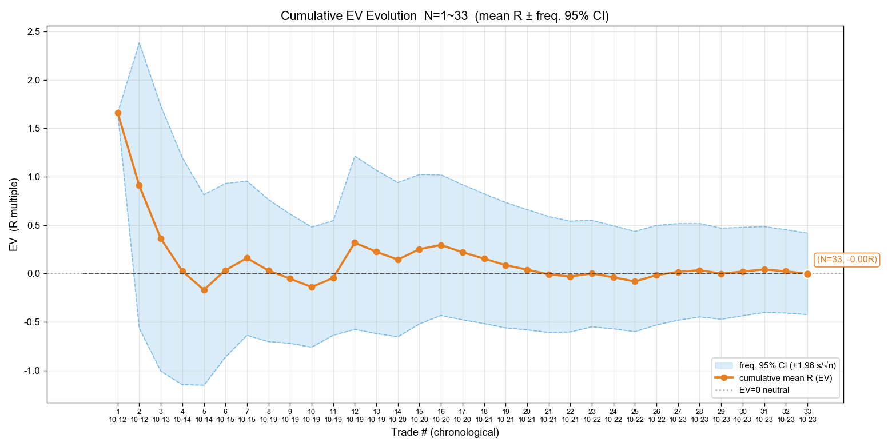

### 5.3 贝叶斯胜率演化

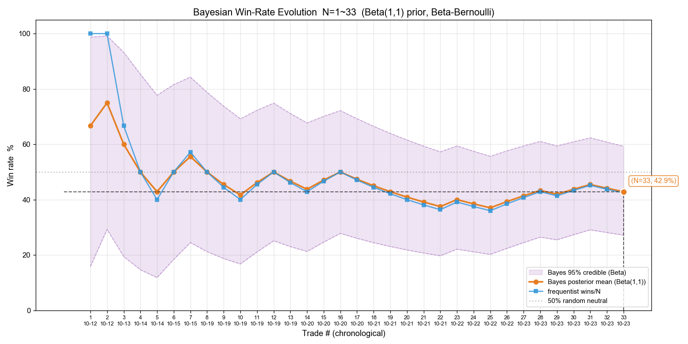

### 5.4 P(g>0) 演化（多 f）

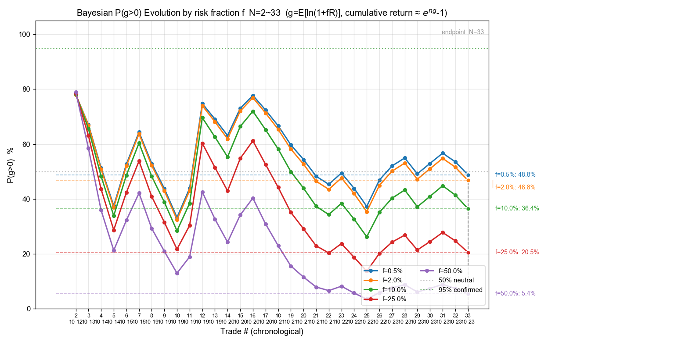

### 5.5 P(∑40≥0) 演化（多 f）

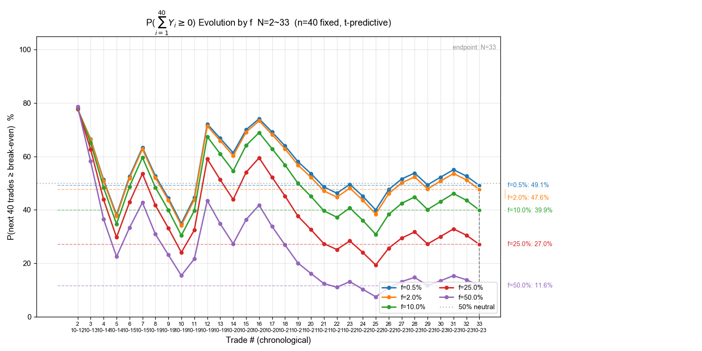

### 5.6 P(g≥ln1.2/40) 演化（多 f）

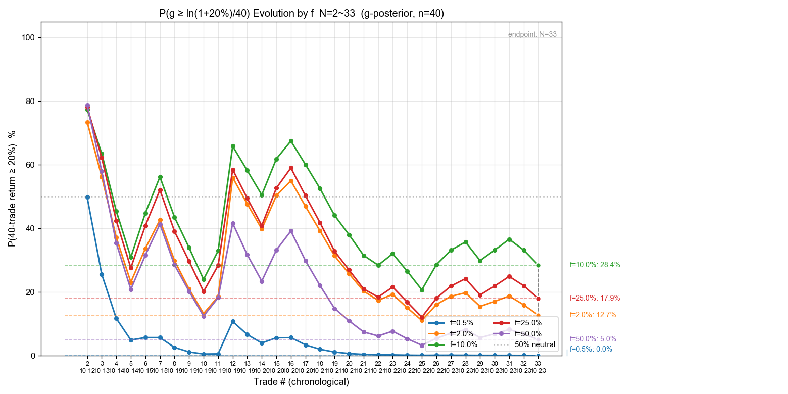

### 5.7 P(∑40≥ln1.2) 演化（多 f）

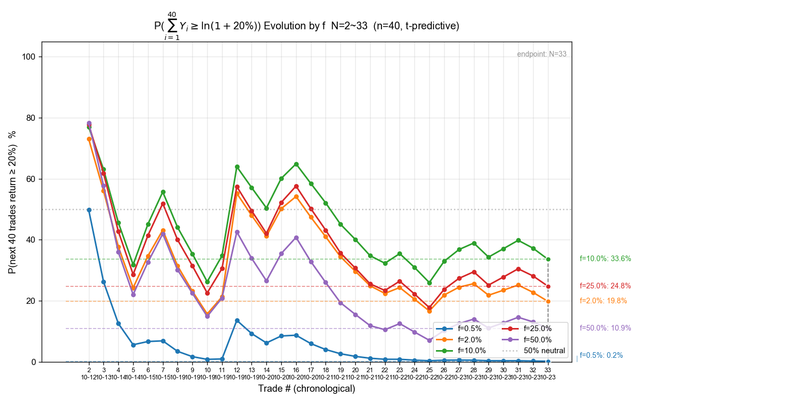

**本节小结**：7 张图都只含 33 个点（横轴 N=1~33 对应 10-12~10-23），各自形态与全量图的「红线右侧」一致，但**去掉了左侧 30 笔的历史包袱后，曲线明显干净**——P(EV>0) 在 30%~50% 区间震荡（不是全量图的 1%~6% 贴地）、EV 在 0 附近上下（不是一路 −0.4R）。这正是「10 月已回到打平」的图形证据，也说明「历史负 EV 主要来自 7-9 月」这一判断成立。

---

## 六、数据质量局限（必须如实标注）

1. **9 笔 R 值超出合理区间（|R|>1.05）**，说明这些笔记录的 max_loss（原始止损）与真实止损价有偏差：
   - `10-19 SOXL 空 R=+4.32`（推算止损距仅占股价 0.34%，明显偏窄）
   - `10-21 GOOG 多 R=−1.12`、`10-22 META 空 R=−1.14`（止损距 0.14~0.15%，极窄导致费占比高、R 越过 −1）
   - 这些笔的真实 R 应由券商账单的原始止损复核；本次保留原记录值、不擅自修改。
2. **过程指标（MAE / MFE / 回吐 / 锁利效率 η）全部缺失**——CSV 无 `raw_high` / `raw_low` 列。要补需按开平仓时间戳回拉富途分钟 K。
3. **第 ② 段（08-28~10-13）13 笔中 2 笔自洽校验偏差 6~14%**（09-11 QQQ、09-14 TSLA），可能因移损后止损被当作原始止损记录；其余 11 笔校验通过。
4. **熔断判据不动用本报告**：项目熔断机制固定用「全体真实样本」（当前 N=87 港股为主），本报告是**美股子集**，两者不可混用。

---

## 七、结论与建议（均标注统计依据强度）

### 结论

1. **美股全量 EV = −0.196R/笔，P(EV>0) = 6.6%**——按现有 63 笔，没有证据支持美股当前可盈利。
2. **亏损高度集中**：6 笔大仓位失败单占全部亏损 92%；剔除后 57 笔合计 +$2,537。**问题不在「每笔都亏」，而在大仓位时的少数崩溃**。
3. **趋势在改善**：月度 EV 从 8 月 −0.497 / 9 月 −0.580 → 10 月 −0.003。10 月 33 笔基本打平（+$457）。
4. **空单胜率是短板**：赔率结构（1.11）优于多单，但胜率 31% 远低于必需的 43.4%。
5. **MU 的胜赔率异常低（0.55）**：赢的时候只赚 0.55R，长期必亏（盈亏平衡需胜率 61%，实际 40%）。

### 建议（按证据强度排序）

**A. 已有统计支撑、可直接执行**
1. **大仓位必须逐笔过全流程自查**：6 笔巨额亏损全是大仓位（净 M ≥$5,253），且 R 集中在 −0.43~−1.00。当前模拟盘被购买力限制在 ≲254 股、单笔净 M $10~300，反而天然限制了单笔崩溃的伤害——**不建议为了「提高收益」而放开这个约束**，除非另有统计证据支持大仓位期望为正。
2. **MU 类「胜赔率 <0.7」的标的应先修止盈逻辑再用**：10 笔 MU 胜赔率仅 0.55，是所有标的里最差。这不是费率问题（费占比很小），是止盈目标离入场太近 / 止损太宽导致赔率结构失衡。

**B. 只是假设、需更大样本验证（不可据此改规则）**
3. **空单需要更严的入场确认**：空单胜率 31%、所需 43.4%，缺口 12pp。假设是「空单入场偏早（左侧）」，需按 reference「右侧入场总则」逐笔标注入场时机后统计，才能确认。
4. **META / LITE 的正 EV 不能当结论**（n=5 / n=4）。若要据此提高这两只的优先级，需各自累积 ≥30 笔。

### 不建议做的事

- **不要**因为 10 月「打平」就认为策略已修复——33 笔 EV −0.003R、CI 必然跨 0，只能说明「不再是 8 月那种崩法」。
- **不要**把本报告的 −0.196R 与港股样本的 +0.097R 直接比较或加权——市场结构、仓位规模、费率结构都不同。

---

## 八、配套产物

| 文件 | 说明 |
|---|---|
| `reviews/2026-10-24-trades-us.csv` | 63 笔全量样本（review.py 口径）|
| `reviews/2026-10-24-us-bayes-evolution.png` | 贝叶斯 P(EV>0) 演化（见 4.1）|
| `reviews/2026-10-24-us-ev-evolution.png` | 累计 EV 演化（见 4.2）|
| `reviews/2026-10-24-us-winrate-evolution.png` | 贝叶斯胜率演化（见 4.3）|
| `reviews/2026-10-24-us-pg-evolution.png` | P(g>0) 演化（见 4.4）|
| `reviews/2026-10-24-us-psum40-evolution.png` | P(∑40≥0) 演化（见 4.5）|
| `reviews/2026-10-24-us-pg20-evolution.png` | P(g≥ln1.2/40) 演化（见 4.6）|
| `reviews/2026-10-24-us-psum40-20pct-evolution.png` | P(∑40≥ln1.2) 演化（见 4.7）|
| `tmp/build_us_trades.py` | 本报告的数据构建脚本（三层数据源合并 + 自洽校验）|
