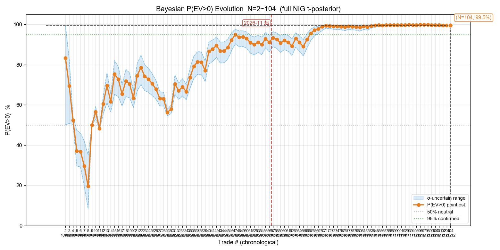
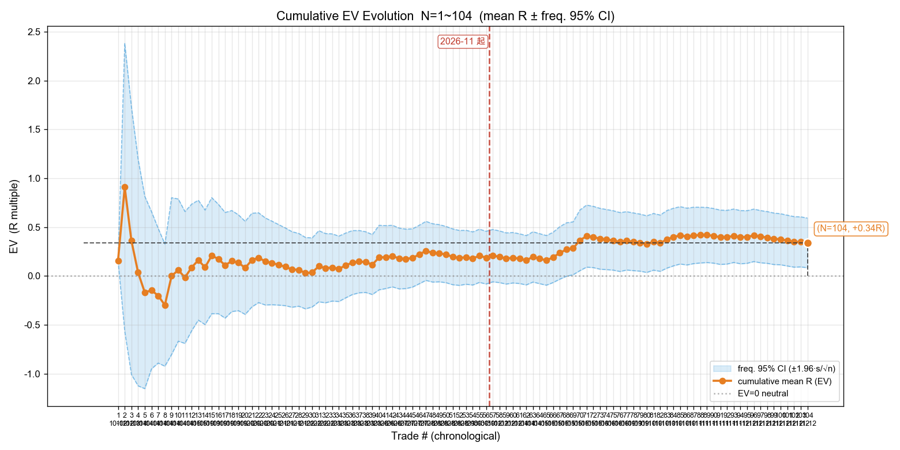
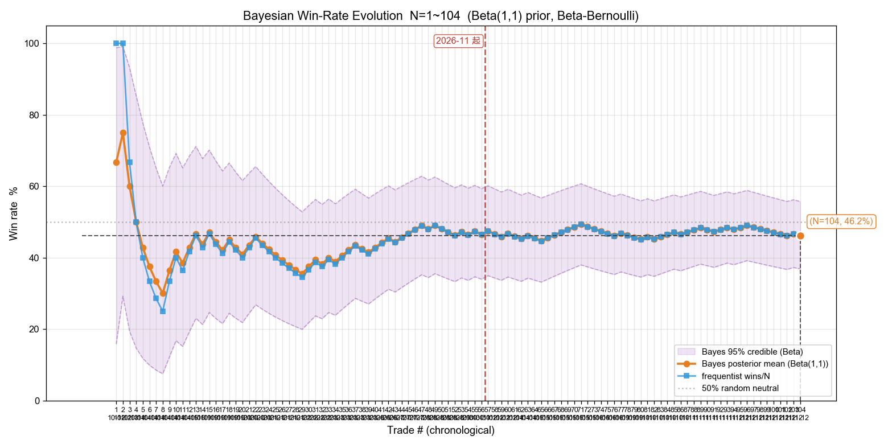
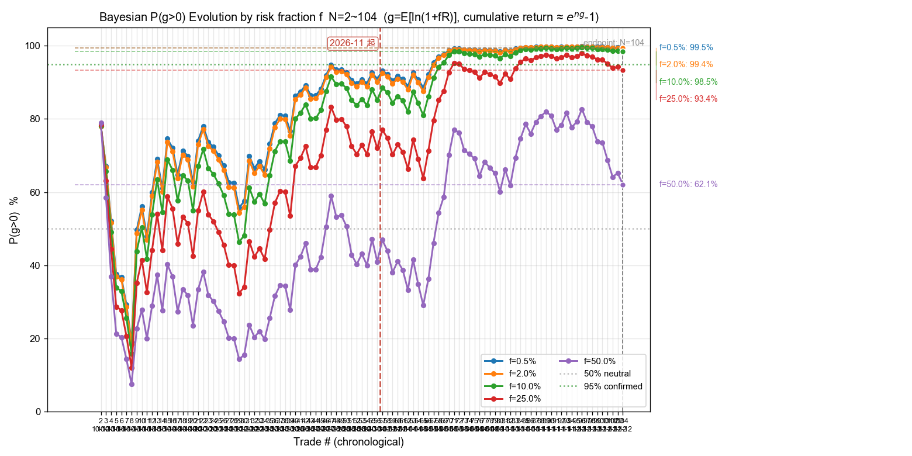
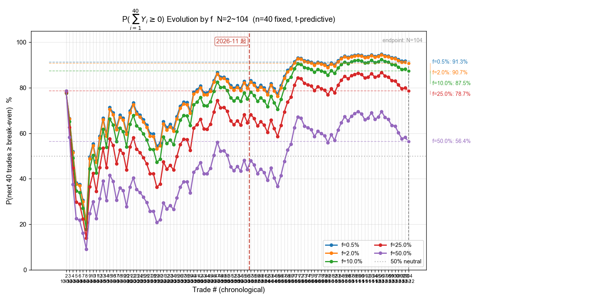
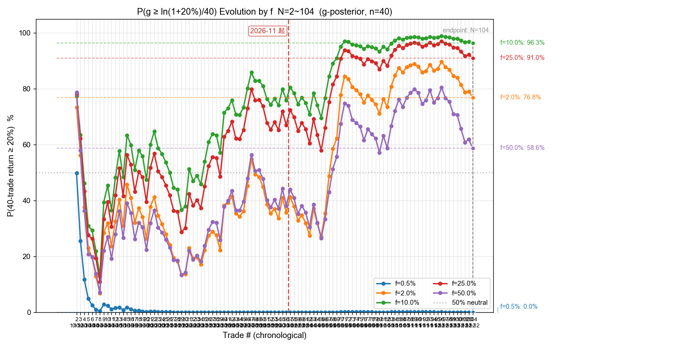
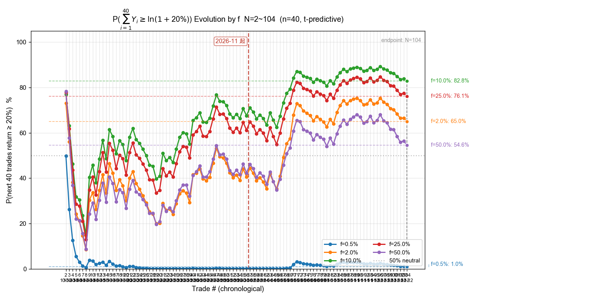

# 美股交易复盘报告 · 10 月份至今（截至 2026-11-12 ET）

> 复盘日期：2026-11-13｜区间：**2026-10-01 ~ 2026-11-12 ET**（10 月首笔为 10-12；ET 11-13 尚在盘前、不计入）
> 样本：`reviews/2026-11-13-trades-us.csv`——**104 笔真实成交**（全部 auto_paper 模拟盘）+ **18 笔影子** = 122 行
> 统计脚本：`review.py` / `bayes_evolution.py`（全部指标实跑输出，无手算）；费率沿用 0.5.0 口径（`fee_schedule.py`）
> 数据源：券商 API `get_orders` 配对（10-24~11-12，65 笔）+ `reviews/2026-10-24-trades-us.csv`（10-12~10-23，39 笔）；影子从 `signals/*-ET-signals.md` 解析
> ⚠️ 本报告是**美股子集**，不是项目全量样本；与港股样本、与正式熔断判据都不可直接混用（见第七节）

---

## 一、样本构成与对账

| 段 | 区间 | 笔数 | 数据源 | 权威性 |
|---|---|---|---|---|
| ① | 2026-10-12 ~ 10-23 | 39 | `reviews/2026-10-24-trades-us.csv`（10-24 复盘已用 API + actions 双向核对）| 已核对的二手产物 |
| ② | 2026-10-26 ~ 11-12 | 65 | 券商 API `get_orders` 配对；原始止损从 `actions/` 与每日明细表匹配 | 最高（真实成交价 / 股数 / 成交时间）|
| 影子 | 2026-10-20 ~ 11-12 | 18 | `signals/*-ET-signals.md` 的【影子】开 / 平仓条目 | 纸面近似，单独统计 |

**对账结果**：

- ✅ ② 段 65 笔全部匹配到原始止损（P0 actions 开仓记录 / P1 每日明细表），**回退到可能被移损的 API 止损腿 0 笔**。11-12 有 4 笔手写格式开仓记录，补全解析器后其中 1 笔的 `max_loss` 从 US$14.11 校正为 US$48.89，避免 R 虚高。
- ✅ 逐日笔数与 `actions/*-ET-actions.md` 的停盯汇总逐日一致（10-26：3、10-27：4、10-28：6、10-29：1、10-30：3、11-02：4、11-03：0、11-04：3、11-05：9、11-06：4、11-09：3、11-10：7、11-11：7、11-12：11）。
- ✅ 与 10-24 复盘衔接：① 段 39 笔单独重算 EV = **+0.117R**，与当时报告一致；新增 ② 段 65 笔 EV = **+0.472R**。
- ✅ 影子 18 开 / 18 平按时间全局配对成功，无未平仓、无孤儿平仓。
- ✅ 交易日历用富途 `request_trading_days(Market.US)` 实测：10-12~11-13 的周一至周五全部为 `WHOLE`（完整交易日），没有半日市或非周末休市日。
- ❌ **10-16（周五）没有任何美股记录**：无动作文件、无信号文件、无停盯总结。它是正常交易日，属记录缺口，不是休市。
- ⚠️ **11-03（周二）有盯盘与停盯总结，但券商对账口径 0 笔成交**：暴跌后震荡整理日，全天未开仓，属「有记录、没交易」，不是漏记。

---

## 二、终局统计（N=104）

| 指标 | 值 |
|---|---|
| 笔数 | 104（57 多 / 47 空）|
| 胜率 | **46.2%**（48 胜 / 56 负）|
| 胜赔率 R_W | **+1.472R** |
| 败赔率 R_L | −0.632R |
| **EV** | **+0.339R / 笔（+33.9%）** |
| 总净盈亏 | **US$+3,641** |
| R 样本标准差 s | 1.323 |
| 贝叶斯 P(EV>0) | **99.5%**（σ 不确定下 98.7%~99.8%）|
| 频率派 EV 95% CI | **[+0.085, +0.593]**（首次全正）|
| P(g>0) @ f=2% | 99.4% |
| P(未来 40 笔不亏) @ f=2% | 90.7% |

**判读**：相比 10-24 复盘的两个口径（全量 69 笔 EV −0.111R、10 月 39 笔 EV +0.117R 且 CI 跨 0），本次 104 笔的 **EV 升到 +0.339R、95% CI 下界首次转正、P(EV>0) 达 99.5%**。按样本量门槛，N=104 已过「N≈50+ 才有确认价值」的线，σ 不确定区间跨度仅 1.1pp，点值有参考意义。

**但有一个必须同时看到的反面**：R 分布强右偏——中位数 **−0.133R**、均值 / 中位数绝对值 2.55 倍、**最大 5 笔盈利的 R 合计占全部 R 合计的 54.5%**。剔除最大 10 笔盈利后 EV 只剩 +0.043R、P(EV>0) 掉到 67.0%。所以「正期望」目前主要由少数大赢单撑起，稳健性分析见 3.6 节，结论措辞据此收窄。

---

## 三、分维度拆解

### 3.1 按月 / 红线两侧

| 区间 | N | 胜率 | EV(R) | 胜赔率 | 败赔率 | 总净盈亏 |
|---|---|---|---|---|---|---|
| 10 月（红线左）| 56 | 46.4% | +0.188 | +1.095 | −0.598 | US$+2,007 |
| 11 月至今（红线右）| 48 | 45.8% | **+0.515** | **+1.918** | −0.672 | US$+1,634 |

胜率几乎没变（46.4% → 45.8%），**EV 提升全部来自胜赔率（1.095 → 1.918）**：11 月赢的时候拿到的 R 明显更大。演化图里的红色竖线画在第 56.5 笔处（11-01 起为第 57 笔）。

### 3.2 按数据源段（只作对账，不作归因）

| 段 | N | 胜率 | EV(R) | 总净盈亏 |
|---|---|---|---|---|
| 旧 CSV 段（10-12~10-23）| 39 | 41.0% | +0.117 | US$+572 |
| API 段（10-26~11-12）| 65 | 49.2% | **+0.472** | US$+3,069 |

两段既是不同数据源、也是不同时间段，市场环境与执行细节都在变，**不能把 EV 差异归因于「数据源更准」**。这里只用来证明 10-24 复盘之后的新样本没有把结论拉坏。

### 3.3 按方向

| 方向 | N | 胜率 | EV(R) | 胜赔率 | 败赔率 | 盈亏平衡所需胜率 |
|---|---|---|---|---|---|---|
| 做多 | 57 | 40.4% | +0.063 | +1.029 | −0.590 | 36.4% |
| 做空 | 47 | **53.2%** | **+0.674** | **+1.880** | −0.697 | 27.1% |

空头在胜率与胜赔率两头都占优，是本期 EV 的主要来源；多头 57 笔只勉强正期望。这与此前「空单赔率结构略好」的观察方向一致，但**属于分组观察、不是回放验证后的规则依据**，暂不建议据此调整方向偏好。

### 3.4 按标的（N≥3）

| 标的 | N | 胜率 | EV(R) | 胜赔率 | 总净盈亏 |
|---|---|---|---|---|---|
| US.SOXL | 36 | 44.4% | +0.201 | +1.223 | US$+1,656 |
| US.MU | 18 | 55.6% | **+1.197** | **+2.746** | US$+1,883 |
| US.SNDK | 8 | 37.5% | −0.093 | +0.873 | US$+104 |
| US.AMD | 7 | 28.6% | −0.263 | +0.833 | US$−324 |
| US.META | 5 | 60.0% | +0.536 | +1.195 | US$+225 |
| US.QQQ | 4 | 75.0% | +0.640 | +0.981 | US$+70 |
| US.TQQQ | 3 | 0.0% | −0.451 | — | US$−354 |
| US.CRWV | 3 | 33.3% | +0.058 | +2.029 | US$+9 |
| US.GOOG | 3 | 0.0% | −0.325 | — | US$−77 |

**MU 是本期最大贡献者**（18 笔、EV +1.197R、胜赔率 2.746），SOXL 仍是主战场（36 笔、EV +0.201R）。TQQQ / GOOG 样本只有 3 笔且全负，只作记录、不下结论。

### 3.5 按仓位规模（净 max_loss）

| 分组 | N | 胜率 | EV(R) | 胜赔率 | 总净盈亏 |
|---|---|---|---|---|---|
| 净 M < US$100 | 39 | **51.3%** | **+0.617** | +1.787 | US$+1,954 |
| US$100 ≤ 净 M < US$300 | 58 | 43.1% | +0.171 | +1.291 | US$+1,313 |
| 净 M ≥ US$300 | 7 | 42.9% | +0.184 | +0.887 | US$+373 |

小仓位组在胜率与胜赔率两头都最好，与 10-24 复盘「小仓位结构更健康」的结论一致。本期已不存在 8 月那种超大仓位单，最大净 M 也未到当时的量级。

### 3.6 极值与稳健性（本报告最重要的一节）

| 处理 | N | EV(R) | P(EV>0) | 说明 |
|---|---|---|---|---|
| 全样本 | 104 | **+0.339** | 99.5% | 基准 |
| 剔除最大 1 笔盈利 | 103 | +0.285 | 99.1% | 单笔影响 0.054R |
| 剔除最大 3 笔盈利 | 101 | +0.221 | 97.4% | 仍偏正 |
| 剔除最大 5 笔盈利 | 99 | +0.162 | 93.4% | 掉出 95% 确认线 |
| 剔除最大 10 笔盈利 | 94 | **+0.043** | **67.0%** | 接近打平、不再显著 |
| 剔除全部 MU | 86 | +0.160 | 92.3% | MU 贡献约一半 EV |
| 把 R>3 截断到 3 | 104 | +0.298 | 99.4% | 结论方向不变 |

- 最大 5 笔盈利：11-05 MU +5.946R / 11-10 MU +3.587R / 11-05 MU +3.447R / 11-05 MU +3.259R / 10-26 SOXL +2.979R。
- 最大 5 笔亏损都在 −1.02R ~ −0.97R 之间，**没有一笔亏穿 −1.05R**；亏损端被止损单守得很整齐。
- `|R| > 1.05` 的共 **29 笔，全部在盈利端**；费占净 M 中位数 4.41%、最大 31.52%。
- 最长连败 7 笔（出现在样本中段）；最近 5 笔 R 为 [−0.079, −1.022, −0.965, +0.342, −0.719]。

**结论要收窄到这里**：本期确实实现了正 EV，且 CI 全正；但盈利高度集中在少数大 R 单，尤其 11-05 / 11-10 的 MU。「策略已经稳定正期望」是过度外推——剔除 10 笔最大盈利后证据就退回到「不足以下结论」。这一层不确定性必须带进任何调参决策。

### 3.7 影子样本（单独一组，不进主统计）

| 组 | N | 胜率 | EV(R) | P(EV>0) | EV 95% CI |
|---|---|---|---|---|---|
| 真实成交 | 104 | 46.2% | +0.339 | 99.5% | [+0.085, +0.593] |
| **影子（被互斥闸拦下的纸面机会）** | **18** | **22.2%** | **−0.155** | 24.7% | [−0.586, +0.276] |

影子样本方向偏负，但只有 18 笔、CI 跨 0、且是「决策时刻价近似、无真实滑点」，与真实样本不同质。**只能取方向、不能据此改护栏**；若以后要评估「先到先得」互斥闸是否恰好筛掉了差机会，需要专门的「先到 vs 被拦」对照回放，不是这份复盘能回答的。

### 3.8 按执行模式分组（复盘必含项）

| 模式 | N | 胜率 | EV(R) | 平均 R |
|---|---|---|---|---|
| auto_paper（模拟盘真实成交）| 104 | 46.2% | +0.339 | +0.339 |
| shadow（影子纸面样本，单独统计）| 18 | 22.2% | −0.155 | −0.155 |
| signal / auto_live | 0 | — | — | — |

本期 10 月至今全部是 auto 模式模拟盘成交，没有 signal 模式信号交易，也没有实盘账户成交；因此「按模式分阶段」在本期没有可比的两段，不能做模式间的退化分析。

### 3.9 样本量规划（代入当前 s=1.323）

| 目标 | 误差 / 假设 | 需要样本 |
|---|---|---:|
| 胜率（p=0.5）| ±5% | 384 笔 |
| 胜率（p=0.5）| ±3% | 1067 笔 |
| EV 估计 | ±0.2R | 168 笔 |
| EV 估计 | ±0.1R | 673 笔 |
| 确认 EV>0（80% 把握）| 真实 EV=+0.10R | 1083 笔 |
| 确认 EV>0（80% 把握）| 真实 EV=+0.20R | 271 笔 |

这些数字用当前样本的 s 代入公式算出，s 本身随样本变化，只作初步规划、不是定论。当前 N=104，连「±0.2R 精度」都还差 64 笔，这也是建议继续攒样本而不是调参的量化理由。

---

## 四、序贯演化图（7 张，随报告展示）

> 生成命令：`bayes_evolution.py --date 2026-11-13 --suffix -us --vline-date 2026-11-01`，横轴为累计交易笔数（N=1~104，按日期 + 标的排序）。
> **🔴 红色竖线 = 11-01 起（第 56.5 笔）**：线左 56 笔为 10 月、线右 48 笔为 11 月，两侧量化对比见 3.1 节。
> 关键节点（脚本实跑输出）：N=10 累计 +0.061R / P 56.5%；N=30 +0.036R / 57.9%；N=40 +0.189R / 86.6%；N=56 +0.188R / 91.2%；N=80 +0.326R / 98.5%；N=104 +0.339R / 99.5%。

### 4.1 贝叶斯 P(EV>0) 演化（NIG t 后验）

- **定义与读法**：每加一笔重算 μ 的 t 后验，实线为点估计、上下两条为 σ 不确定区间的两端；50% 是中性线、95% 是确认线。点值高但下界低说明信念还靠不住。
- **关键节点**：前 30 笔在 50%~65% 之间反复，方向不明；第 40 笔（10-26 SOXL +2.979R）把点值推到 86.6%；10 月末（N=56）91.2%；11 月 MU 的几笔大赢单把 N=80 推到 98.5%，终局 **99.5%（98.7%~99.8%）**。
- **终局与对比**：10-24 复盘的全量终局是 15.4%、10 月子集 77.1%；本次 99.5% 且区间整体 >95%，是本项目美股样本第一次达到「区间确认正期望」。
- **含义**：证据累积方向明确，但配合 3.6 节看，这个 99.5% 对「最大几笔盈利」很敏感——它证明的是「这批 104 笔的平均为正」，不是「未来每笔都稳」。

### 4.2 累计 EV 演化（均值 R ± 频率派 95% CI）

- **定义与读法**：主线是逐笔累计平均 R，灰带是 EV ± 1.96·s/√n 的 95% CI，0 线是期望分界。主线高于中位数很多时说明分布右偏。
- **关键节点**：N=10 累计 +0.061R、CI [−0.67, +0.79]；N=30 回落到 +0.036R；N=40 跳到 +0.189R；**CI 下界在 N≈80 首次转正**（[+0.04, +0.62]）；终局 **+0.339R、CI [+0.08, +0.59]**。
- **终局与对比**：10-24 的 10 月子集终局 +0.117R 且 CI 跨 0，本次 +0.339R 且 CI 全正；但 s 从 0.977 升到 1.323，CI 仍宽达 ±0.254R。
- **含义**：幅度上「每笔平均赚 0.34R」看着厚，可中位数是 −0.133R——**平均被少数尖峰拉起来的形态在这张图上一目了然**，读这张图必须同时读 3.6 的剔除表。

### 4.3 贝叶斯胜率演化（Beta(1,1) 先验）

- **定义与读法**：贝叶斯后验均值主线（弱信息 Beta(1,1)）、频率法 wins/N 对照线、后验 95% 可信区间灰带、50% 抛硬币中性线。小样本两线分叉大，后期趋同。
- **关键节点**：早期在 33%~60% 之间摆动；10 月末（N=56）收敛到 46.4%；11 月 48 笔胜率 45.8%，几乎没动，终局 **46.2%**。
- **终局与对比**：10-24 的 10 月子集是 41.0%，本次高 5.2pp，但**仍低于 50%**；靠赔率而不是胜率赚钱的结构没变。
- **含义**：胜率是凯利仓位的核心输入，46% 的估计在 N=104 下已趋稳，但 95% 可信区间仍宽；不要拿它当精确参数去放大下注比例。

### 4.4 按风险比例 f 的 P(g>0) 演化

- **定义与读法**：g = E[ln(1+fR)] 是固定比例下注的每笔对数增长率，P(g>0) 回答「长期复利是否增长」；五条线对应 f=0.5% / 2% / 10% / 25% / 50%。小 f 区各线重合，大 f 区方差惩罚 f²σ²/2 显现。
- **关键节点**：10 月前段各线在 60%~90% 波动；11 月大赢单后小 f 档升到 99% 以上，f=50% 档只到 62%。
- **终局多 f 表**：f=0.5% **99.5%**、2% **99.4%**、10% 98.5%、25% 93.4%、50% **62.1%**；ĝ 在 f=25% 时最高（+4.117%/笔），f=50% 回落到 +1.582%/笔。
- **含义**：正 EV 下仍不能无限放大 f——越过约 2f* 后概率明显下滑，这条曲线是第五节「尾部红线」的依据。

### 4.5 P(∑40 笔 ≥ 0) 演化

- **定义与读法**：固定 n=40，用 t 预测近似算「接下来 40 笔对数收益和不亏」的概率，与 4.4 同源但回答短期、不回答长期；P(g>0) ≥ 本图值。
- **关键节点**：前 40 笔在 55%~75% 徘徊，11 月后抬到 88%~91% 区间并走平。
- **终局多 f 表**：f=0.5% **91.3%**（全网格最高）、2% 90.7%、10% 87.5%、25% 78.7%、50% 56.4%。
- **含义**：**即便长期 edge 已被 99.5% 确认，未来 40 笔仍有约 9% 概率累计亏损**；且所有 f 都达不到「不亏概率 ≥95%」的硬约束（见第五节）。

### 4.6 P(g ≥ ln(1.2)/40) 演化（达成 20% 所需的单笔增速）

- **定义与读法**：把 4.4 的阈值从 0 提到 ln(1.2)/40，问「长期增速够不够 40 笔累计涨 20%」。⚠️ **这是期望口径，把 40 笔随机路径压成长期均值 g 折算门槛，丢掉路径方差、系统性偏高；「40 笔达 20% 的概率」以 4.7 为准。**
- **关键节点**：f=0.5% 全期贴近 0；f=2% 在 11 月后才越过 50%；大 f 档更早抬头但受方差惩罚压制。
- **终局多 f 表**：f=0.5% 0.0%、2% **76.8%**、10% **96.3%**、25% 91.0%、50% 58.6%。
- **含义**：保守比例能保增长但够不到收益目标，中等 f 才兼顾两者；它只是参数门限的辅助判断，不能当成达标概率读。

### 4.7 P(∑40 笔 ≥ ln(1.2)) 演化（40 笔累计 ≥ +20%）

- **定义与读法**：4.5 的 target=20% 版，含个体方差的预测概率，是「接下来 40 笔能否赚 20%」的正确图。
- **关键节点**：10 月段随累计均值在 10%~40% 波动；11 月大赢单后 f=2% 档抬到 60% 以上，f=8%~10% 档在 82%~83% 见顶。
- **终局多 f 表**：f=0.5% 1.0%、2% **65.0%**、10% **82.8%**、25% 76.1%、50% 54.6%。
- **含义**：**「不亏」与「达目标」是两个独立约束**——f=0.5% 时 P(不亏)=91.3% 却几乎不可能达 20%；当前 f=2% 下 P(达目标)=65.0%，比 10-24 复盘全量的 2.7% 已是数量级改善。

---

## 五、科学选 f（四步框架，全部实算）

### ⓐ f 细网格（n=40；节选，完整 50 档见 `tmp/analysis.txt`）

| f | P(∑40Y≥0)「不亏」| P(∑40Y≥ln1.2)「达 20%」| P(g>0) | ĝ |
|---|---|---|---|---|
| 0.5% | **91.3%** | 1.0% | 99.5% | +0.167%/笔 |
| 1.0% | 91.1% | 30.3% | 99.4% | +0.330%/笔 |
| **2.0%（当前 f_max）** | **90.7%** | **65.0%** | **99.4%** | +0.642%/笔 |
| 5.0% | 89.6% | 80.9% | 99.1% | +1.481%/笔 |
| 10.0% | 87.5% | **82.8%** | 98.5% | +2.588%/笔 |
| 15.0% | 84.9% | 81.4% | 97.4% | +3.375%/笔 |
| 20.0% | 82.0% | 79.1% | 95.8% | +3.878%/笔 |
| 25.0% | 78.7% | 76.1% | 93.4% | +4.117%/笔 |

### ① 约束优化

硬约束取 P(∑40Y≥0) ≥ 95%，在其上最大化 P(达 20%)。实跑 0.5%~25% 共 50 档：**没有任何一档满足约束**，最高只有 f=0.5% 的 91.3%。原因是本次 EV/s = 0.339/1.323 ≈ 0.256，在 N=104、n=40 的 t 预测下最大 t 统计量约 1.38，达不到 95% 对应的 1.645。**约束无可行解，按框架进入稳健性收缩，不放量。**

### ② 凯利交叉验证

按样本估 f* = p/|R_L| − q/R_W ≈ **36.4%**（实算）。小样本 + 移动止损锁利使 |R_L| 偏小，这个 f* 系统性高估，只作参考。当前 f_max=2% 约为 f* 的 **5.5%（≈1/18）**，落在很保守的分数凯利区，符合「edge 未稳固时收缩」的方向。

### ③ 稳健性收缩

P(EV>0) 虽达 99.5%，但 3.6 节显示剔除 10 笔最大盈利后 P 掉到 67.0%、CI 重新跨 0；加上约束优化无解，**当前不满足「释放到约束最优解」的条件**，维持风控上限 f_max=2%。

### ④ 尾部红线

P(g>0) 在 f≈22% 时跌破 95%，f=50% 时 P(∑40≥0) 只剩 56.4%、ĝ 也从峰值回落。硬上限应远低于这些档位。

### ⓑ 决策表

| 档 | f | 触发条件 |
|---|---|---|
| 当前阶段 | **2%**（维持）| 约束无可行解 + 盈利集中于少数大 R 单 |
| edge 确认后 | 重新评估（不预设值）| 再攒样本，且「剔除前 10 笔最大盈利后」P(EV>0) 仍 >95%、CI 下界仍为正、胜率 CI 下界脱离 50% |
| 尾部上限 | 约 20% 以内 | P(g>0) 跌破 95% 的临界 |

### ⓒ 不亏 ≠ 达目标

f=0.5% 时 P(不亏)=91.3%、P(≥20%) 只有 1.0%；f=2% 时 90.7% 与 65.0%。**保生存看 P(g>0) 与 P(不亏)，达目标看 P(≥20%)，两个约束独立，不能用前者替后者做决策。**

---

## 六、数据质量局限（如实标注）

1. **右偏与极端 R**：29 笔 |R|>1.05 全在盈利端，5 笔 R>3，最大 +5.946R（11-05 MU，净 M 仅 US$69）。窄止损记录会把 R 放大，这些笔的原始止损与真实止损是否完全一致，未逐笔回查券商账单；本报告保留原记录、未擅自改值。
2. **过程指标缺失**：CSV 无 `raw_high` / `raw_low`，MAE / MFE / 回吐 / 锁利效率全部跳过。要补需按开平仓时间戳回拉富途分钟 K。
3. **两段数据源口径不同**：① 段 39 笔里有一部分 `max_loss` 是 10-24 复盘时按「文档落地赔率反推」的次级口径；② 段 65 笔是 API 成交 + 原始止损匹配。合并统计是现有数据的最完整口径，但不是完全同质的样本。
4. **API 回查窗口**：本次实测 `get_orders` 只返回 10-22 起的订单，10-12~10-21 依赖 10-24 复盘产物，无法用现时 API 二次复核。
5. **记录完整性**：10-16 整个交易日无记录；11-03 有盯盘无成交。两者已在第一节标注，未用任何插值补齐。
6. **熔断口径**：本次是美股子集，项目正式熔断判据固定用全体真实样本（以港股为主），**两者不可混用**；第七节按实际状态文件给结论。
7. **影子样本**：纸面近似、无真实滑点，只单独报告，不与真实样本混算。

---

## 七、结论与建议（含实盘熔断结论）

### 结论

1. **10 月至今 104 笔美股真实成交：EV +0.339R、胜率 46.2%、P(EV>0) 99.5%、EV 95% CI [+0.085, +0.593] 首次全正**（依据：本次全样本实跑）。这是 10-24 复盘「10 月 39 笔 +0.117R、CI 跨 0」之后的延续改善。
2. **改善来自赔率不是胜率**：11 月胜赔率 1.918 vs 10 月 1.095，胜率几乎没变；空头（EV +0.674R）明显强于多头（+0.063R）。
3. **正期望不稳健**：中位数 −0.133R，最大 5 笔盈利占全部 R 合计 54.5%；剔除最大 10 笔盈利后 EV +0.043R、P(EV>0) 67.0%。「策略已稳定正期望」是过度外推。
4. **小仓位结构最好**：净 M < US$100 的 39 笔 EV +0.617R，优于中大仓位组；亏损端没有一笔亏穿 −1.05R，止损执行整齐。
5. **影子 18 笔 EV −0.155R、CI 跨 0**，只取方向，不足以评估互斥闸的筛选效果。

### 建议（按证据强度）

**A 级（有本次 104 笔全样本统计支撑）**

1. **维持当前 f_max=2% 与小仓位**：f 网格显示 95% 不亏约束无可行解，小仓位组 EV 最优；本期没有任何证据支持放量或放宽护栏。
2. **不改任何硬护栏 / 拒单规则**：按项目「交易逻辑建议必须有数理统计基础」的规矩，护栏类改动要过全样本回放；本次虽然 N=104，但剔除极值后结论不再显著，**不具备改护栏的统计条件**。
3. **继续攒样本再复标**：按当前 s=1.323，EV 估计要 ±0.2R 精度需 168 笔、±0.1R 需 673 笔；确认「真实 EV=+0.2R」需 271 笔。建议再跑 60~100 笔后重跑本复盘，重点看「剔除前 10 笔最大盈利」后的 P(EV>0) 能否站住 95%。
4. **复核极端 R 单的止损记录**：把 11-05 / 11-10 MU 那几笔 R>3 的原始止损与券商订单流逐笔对账，确认不是窄止损记录把 R 放大（数据质量动作，不改策略）。

**B 级（观察 / 假设，需回放验证）**

5. 空头结构优于多头、MU 贡献约一半 EV、影子样本偏负，这三条都只是分组观察，需专门的对照回放才能变成规则依据，本期不作为已定结论。

**不建议做的事**

- 因 CI 转正就认为策略已经修好、或把 f 提到 10%（那只是「达 20% 概率」更高，不亏概率反而更低）。
- 把本报告与港股样本直接比较或加权；把美股子集当成熔断判据的数据源。

### 实盘熔断结论（复盘固定输出项）

**建议：维持熔断，不重启实盘。**

- 项目状态文件 `state/circuit_breaker.json` 当前为 **tripped**（2026-10-04 由全量 87 笔样本触发：P(g>0)@2% = 65.7% < 80% 且连续 5 笔无盈利），至今没有 reset 记录。
- 本次美股子集的机械判读**不触发新的熔断**：P(g>0)@2% = 99.4%（距 80% 线 19.4pp）、最近 5 笔有 1 笔盈利，`state/losing_streak.json` 当前 streak=0。注意 `review.py` 在 worktree 里读不到主工作区的状态文件，其输出末尾会回退显示「ok（未熔断）」，**那不是项目的真实状态**，以主工作区 `state/circuit_breaker.json` 为准。但按 10-24 复盘已立的口径，**美股子集不用于解除熔断**。
- 重启三项判据里，「模拟验证段 ≥10 笔且无 3 连败」这一项本次整段样本**不满足**（最长连败 7 笔），「修整结论已出」也需另立正式复盘；用户未要求重启，因此不发起 AskUserQuestion。
- 结论一句话：**继续用模拟盘 / 信号攒样本，实盘维持 tripped，等正式的全量复盘走完重启流程再谈。**

---

## 八、配套产物

| 文件 | 说明 |
|---|---|
| `reviews/2026-11-13-trades-us.csv` | 122 行样本（104 真实 + 18 影子），review.py 口径 |
| `reviews/2026-11-13-us-*-evolution.png` | 7 张序贯演化图（含 11-01 红线）|
| `tmp/build_oct_us.py` / `tmp/build_shadows.py` | 数据构建脚本（API 配对 + 原始止损匹配 + 影子 FIFO 配对）|
| `tmp/analyze_us.py` / `tmp/analysis.txt` | 分组统计与科学选 f 网格的实算脚本与输出 |
| `tmp/review_main.txt` / `tmp/review_shadow.txt` / `tmp/bayes_run.txt` | review.py 主样本 / 影子子集 / 演化图脚本的原始输出 |
