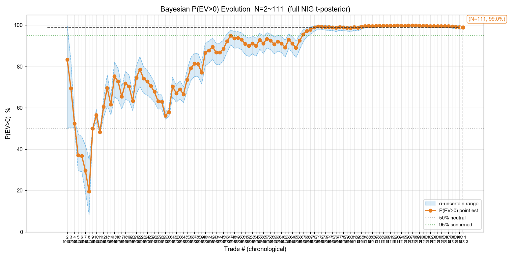
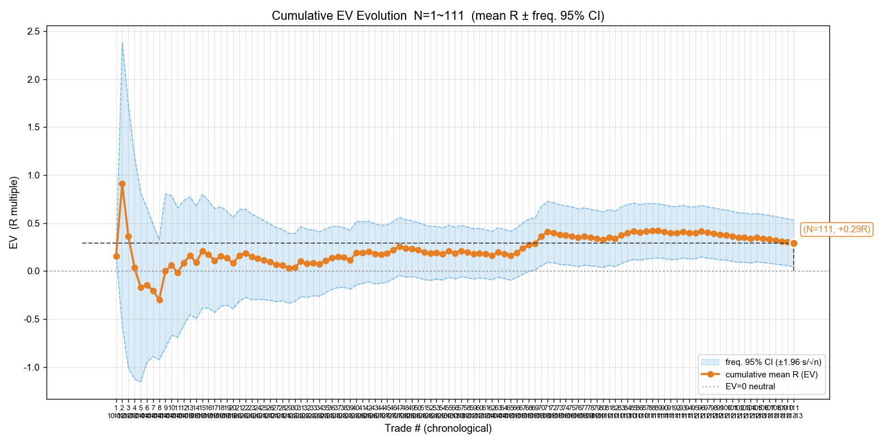
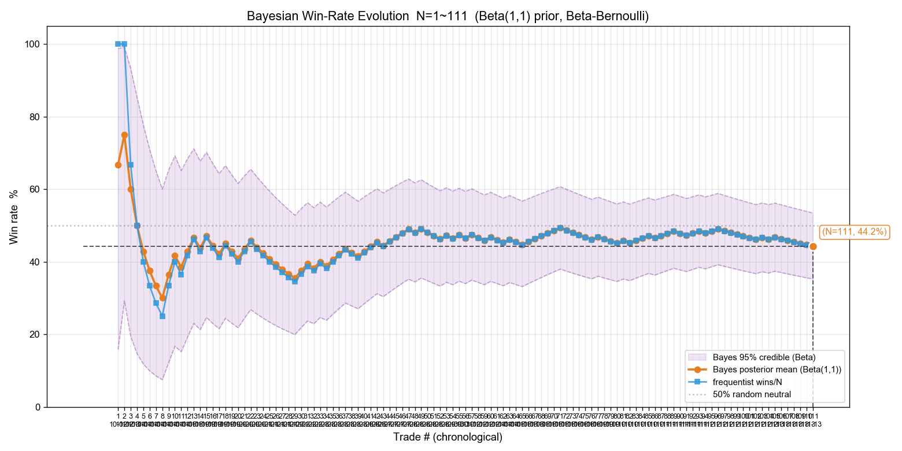
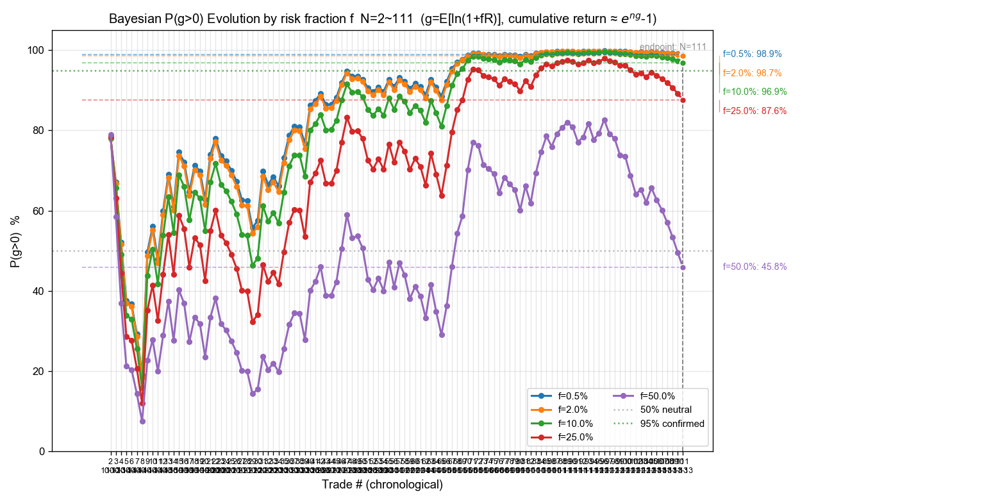
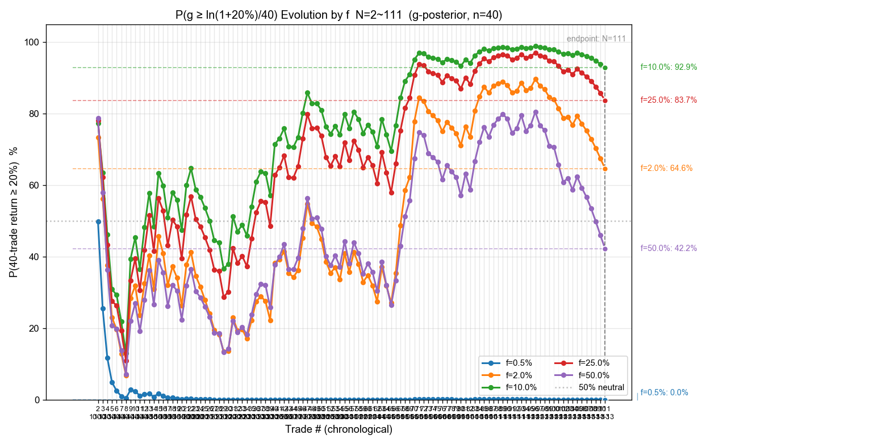
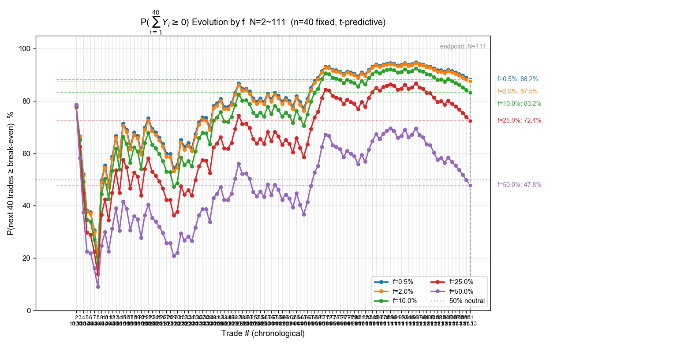
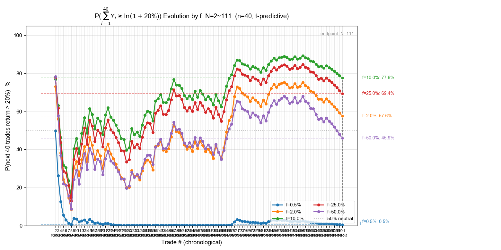

# 美股复盘报告 · 10 月份至今（截至 2026-11-13 ET）· 含影子样本 + 净赔率期望 / 标准误 / t 检验

> 复盘日期：2026-11-14（北京）｜数据文件：`reviews/2026-11-14-trades-us.csv`（133 行 = 真实 111 + 影子 22）
> 口径：R = 净盈亏 ÷ 净 max_loss（2026-08-28 净口径，与 `review.py` 同源）；金额单位 US$，美元一律写 `US$`
> 上一版：`reviews/2026-11-13-review-us.md`（N=104，截至 11-12）

## 一、样本构成与对账

| 段 | 区间 | 笔数 | 来源 |
|---|---|---|---|
| ① | 2026-10-12 ~ 10-23 | 39 | `reviews/2026-10-24-trades-us.csv`（10-24 复盘已用券商 API + actions 双向核对）|
| ② | 2026-10-26 ~ 11-12 | 65 | 券商 API `get_orders` 配对 + 原始止损从 `actions/` 匹配 |
| ③ | 2026-11-13（本次新增）| 7 | `actions/2026-11-13-ET-actions.md`（NVDA 3 笔 + NVD 4 笔）|
| 影子 | 2026-10-20 ~ 11-13 | 22 | `signals/*-ET-signals.md` 的【影子】开 / 平仓条目 |

**逐日对账（本轮重跑）**：10-12 ~ 11-13 共 24 个有记录的交易日（25 个工作日去掉 10-16），`actions/*-ET-actions.md` 里「🟢 开仓」条数与 CSV 真实成交笔数**逐日完全一致**（10-12：2、10-13：1、10-14：8、10-15：2、10-19：6、10-20：4、10-21：5、10-22：4、10-23：7、10-26：3、10-27：4、10-28：6、10-29：1、10-30：3、11-02：4、11-03：0、11-04：3、11-05：9、11-06：4、11-09：3、11-10：7、11-11：7、11-12：11、11-13：7）。

**本轮新增的 11 行**：

- 真实 7 笔（全部 `auto_paper`）：NVDA short ×3（−US$86.24 / −102.07 / −62.01）、NVD（2x 做空 NVDA 的 ETF）long ×4（+US$358.19 / −217.56 / −187.40 / −213.38）。
- 影子 4 笔（全部 US.NVDA short）：162.35 止损（−1.000R）、160.34 主动平（+0.579R）、160.20 止损（−1.000R）、160.64 主动平（−0.184R）。
- ⚠️ 其中第 4 笔影子（ET 11:35 开 / 12:05 平）被 `shadow_trade.py` 按**本机北京日期**写进了 `signals/2026-11-14-ET-signals.md`，本轮按 ET 交易日归位到 11-13（成因与修法见 TODO `T195US`）。

**数据缺口（照实标注）**：

- ❌ **10-16（周五）无任何美股记录**：无 actions、无 signals、无停盯总结。它是正常交易日，属记录缺口，不是休市。
- ⚠️ **11-03（周二）有盯盘与停盯总结、0 笔成交**：属「有记录、没交易」，不是漏记。
- ⚠️ **过程指标（MAE / MFE / 回吐 / 锁利效率 η）本轮缺失**：CSV 未提供 `raw_high` / `raw_low`，需回拉富途分钟 K 才能补，本轮不做。

## 二、三组终局统计

| 指标 | 真实（auto_paper） | 影子（shadow） | 合并 |
|---|---|---|---|
| N | **111** | **22** | **133** |
| 胜 / 负 | 49 / 62 | 5 / 17 | 54 / 79 |
| 胜率 | **44.1%** | **22.7%** | **40.6%** |
| 胜赔率 R_W | +1.471R | +1.224R | +1.448R |
| 败赔率 R_L | −0.642R | −0.619R | −0.637R |
| **EV（均值 R）** | **+0.2906R** | **−0.1997R** | **+0.2095R** |
| 总净盈亏 | +US$3,148.68 | −US$552.63 | +US$2,596.05 |
| R 合计 | +32.25R | −4.39R | +27.86R |

**与上一版（N=104）对比**：真实组 EV 由 **+0.339R 降到 +0.291R**、胜率 46.2% → 44.1%。差异全部来自新增的 11-13 一天——这 7 笔的均值 R 是 **−0.430R**（券商账本口径这 7 笔净 −US$510，模型口径 −US$492），按 104/111 的权重摊下来正好把 +0.339R 拉到 +0.2905R（(104×0.339 + 7×(−0.430)) ÷ 111 = +0.291R）。也就是说：**上一版「95% CI 首次全正」是在 11-13 这天之前成立的，加上这天后真实组 CI 下界仍为正（+0.045）但已薄到 0.045R**。

## 三、净赔率的数学期望、标准误与 t 检验（本轮核心）

### 3.1 定义与公式

对已平仓样本的净赔率序列 $R_1,\dots,R_N$：

$$\hat\mu=\bar R=\frac1N\sum_{i=1}^{N}R_i \qquad s=\sqrt{\frac{1}{N-1}\sum_{i=1}^{N}(R_i-\bar R)^2} \qquad \mathrm{SE}=\frac{s}{\sqrt N}$$

$$t=\frac{\bar R}{\mathrm{SE}},\quad df=N-1,\quad \text{95\% CI}=\bar R\pm t_{0.975,\,N-1}\cdot\mathrm{SE}$$

检验 $H_0:\mathbb{E}[R]=0$（双侧），单侧版本对应 $H_1:\mathbb{E}[R]>0$。

### 3.2 三组结果（`scipy.stats` 实算）

| 组 | N | 期望 $\hat\mu$ | s | **SE** | **t** | df | 双侧 p | 单侧 p(EV>0) | 95% CI（t 口径）|
|---|---|---|---|---|---|---|---|---|---|
| 真实 | 111 | **+0.2906R** | 1.3080 | **0.1242** | **+2.341** | 110 | **0.0211** | 0.0105 | **[+0.0445, +0.5366]** |
| 影子 | 22 | −0.1997R | 0.8924 | 0.1903 | −1.050 | 21 | 0.3057 | 0.847 | [−0.5954, +0.1959] |
| 合并 | 133 | **+0.2095R** | 1.2593 | **0.1092** | **+1.918** | 132 | **0.0572** | 0.0286 | **[−0.0065, +0.4255]** |

**按参数检验（t）的直读**：

- **真实组**：t=2.34、双侧 p=0.021 < 0.05 → 在「R 服从正态分布」的前提下，拒绝「期望为 0」，点估计 **+0.29R/笔 ± 0.12R（1 SE）**。
- **合并组**：t=1.92、双侧 p=0.057（单侧 0.029）→ 处在 5% 边界外侧，CI 下界 −0.0065R **刚好跨过 0**；bootstrap 95% CI 为 [+0.0024, +0.4315]，勉强不跨 0。两种方法给出相反的边界判定，属「证据不足以下定论」的典型区间。
- **影子组**：t=−1.05、p=0.31 → 既不能拒绝「期望为 0」，也无法确认它是负的；方向偏负。

### 3.3 前提检查：这个 t 检验能不能照字面读？不能。

| 检查 | 结果 | 含义 |
|---|---|---|
| Shapiro-Wilk 正态性（真实）| W=0.855，**p=4.8×10⁻⁹** | 强烈偏离正态，t 检验的正态前提不成立 |
| 偏度（真实）| **+1.37**（合并 +1.41）| 右偏，长尾在盈利侧 |
| 中位数 vs 均值（真实）| −0.2207 vs +0.2906 | **中位数是负的**，均值转正全靠右尾 |
| 10% 缩尾均值（真实）| **+0.1076R** | 削掉两端各 10% 后只剩三分之一 |
| 最大 5 笔盈利合计（真实）| +19.22R = **R 合计的 59.6%** | 少数大赢单撑起全部利润 |
| 剔除最大 5 / 10 笔盈利后（真实）| +0.1230R / **+0.0105R** | 剔 10 笔后几乎归零 |
| Wilcoxon 符号秩（真实）| W=2765，**p=0.313** | 不依赖正态的配对位置检验：**不显著** |
| bootstrap 20,000 次（真实）| [+0.0541, +0.5389] | 与 t 口径一致（下界为正）|

**结论必须写成两层**：按参数 t 检验，真实组期望显著为正（p=0.021）；但这个显著性**建立在一个右偏重尾、中位数为负的分布上**——非参数检验（Wilcoxon p=0.31）和缩尾 / 剔尾处理都不支持「稳定正期望」。稳健的表述是：**「EV 点估计 +0.29R、SE 0.12R；按 t 检验 p=0.021，但分布强右偏、收益集中度高，正期望的证据强度远低于 p 值给人的印象」。**

### 3.4 两样本 Welch t 检验：真实 vs 影子

| 项 | 值 |
|---|---|
| 真实均值 − 影子均值 | **+0.4903R** |
| 差的标准误 | 0.2272 |
| t（Welch，df≈41.3）| **+2.158**，双侧 p=**0.0368** |
| Mann-Whitney U（不依赖正态）| p=0.0735 |

**读法**：参数检验说两组在 5% 水平上有差异（真实组更好）；非参数检验只到 7.4%，属边界。结合影子只有 22 笔（s=0.89），**能说的是「影子组大概率比真实组差」，不能说「已确认差这么多」**。这一条对「影子能不能当真实样本用」有直接意义：不能——混算会把真实 EV 从 +0.291 拉低到 +0.210。

### 3.5 分组拆分（真实组）

**按月**：

| 月 | N | 均值 | s | SE | t | p（双侧）|
|---|---|---|---|---|---|---|
| 2026-10 | 56 | +0.188R | 1.030 | 0.138 | +1.37 | 0.177 |
| 2026-11 | 55 | +0.395R | 1.544 | 0.208 | +1.90 | 0.063 |

两个月单独看都**不显著**；合并起来显著，说明单月样本量（55 左右）本身不够——这也是「不要按单月结论调参」的直接证据。

**按模式**（复盘必含项）：本次全部真实成交都是 `auto_paper`（模拟账户），无 `signal`、无 `auto_live`。

## 四、序贯演化图（7 张，真实样本，N=111）

### 4.1 贝叶斯 P(EV>0) 演化（NIG t 后验）

终局：**P(EV>0)=99.0%**（σ 不确定区间 98%~100%）。注意贝叶斯与 t 检验结论一致（都是「均值偏向正」），但同样由右尾驱动，须与 4.2 一起读。

### 4.2 累计 EV 演化（均值 R ± 频率派 95% CI）

终局：累计均值 +0.291R、95% CI [+0.05, +0.53]。曲线在 **N=71 时最高（+0.408R）**，之后一路回落（N=80 时 +0.326R、N=109 时 +0.311R、终局 +0.291R）——**点估计的波动幅度（变化 0.12R）与它的 1 SE（0.12R）同量级，说明序贯曲线的高点不代表稳态**，也不能当作「策略在变好 / 变坏」的判据。

### 4.3 贝叶斯胜率演化（Beta(1,1) 先验）

终局胜率 44.1%（从 10-24 的 46.2% 回落），仍在 40%~50% 区间内震荡。

### 4.4 ~ 4.7 固定比例下注的四个概率族

| f | ĝ（每笔对数增速）| P(g>0) | P(∑40 笔 ≥ 0) | P(∑40 笔 ≥ +20%) |
|---|---|---|---|---|
| 0.5% | +0.143% | 98.9% | 88.2% | 0.5% |
| 2.0% | +0.547% | **98.7%** | **87.5%** | **57.6%** |
| 10.0% | +2.130% | 96.9% | 83.2% | 77.6% |
| 25.0% | +3.030% | 87.6% | 72.4% | 69.4% |
| 50.0% | −0.524% | 45.8% | 47.8% | 45.9% |

读法不变：$f\le2\%$ 时「不亏」概率很高（≈88%），但「40 笔累计 ≥ +20%」只有 57.6%；$f=50\%$ 已经越过两倍凯利边界（ĝ 转负），验证方差惩罚项。

## 五、影子样本单独一组（N=22）

| 指标 | 值 |
|---|---|
| 笔数 / 胜率 | 22 / **22.7%**（5 胜 17 负）|
| EV ± SE | **−0.1997R ± 0.1903R** |
| t / p | −1.05 / 0.306 |
| 中位数 | −0.3484R |
| 总净盈亏 | −US$552.63 |
| 分布特征 | 偏度 +0.94；剔除最大 5 笔盈利后均值 −0.6185R |

**解读（三条，按证据强度排序）**：

1. **影子组大概率比真实组差**（Welch p=0.037、Mann-Whitney p=0.074）：互斥闸拦下的机会里，相当一部分是「同一形态的迟到入场」——真实仓已经进场、价格走了一段，影子在更差的位置假设成交。11-13 这天最典型：3 笔影子全部落在区间震荡的同一个价格带，2 笔打满 −1R。
2. **影子组的 EV 数字不能当真实战绩引用**：它是决策时刻价近似、无滑点、无真实成交冲击，且历史影子结算 R 有旧口径遗留（TODO `T192HKUS`，08-28 之前的影子 R 用移损后的止损价做分母，会把 |R| 放大）。本轮 CSV 里影子行的 `max_loss` 记的是开仓时点的**初始止损**毛值，与 `review.py` 的净分母反推口径一致，近端样本（10-20 起）可用；08-28 之前的历史影子未纳入本次范围。
3. **合并统计必须两个数都给**：只看合并（+0.210R）会低估真实组，只看真实（+0.291R）会忽略「被拦机会其实更差」这条信息——后者对「互斥闸是否在误伤」的判断有用（结论：**闸拦下的机会质量更低，没有证据说明它在系统性误伤好机会**）。

## 六、数据质量与统计局限（照实写）

1. **11-13 新增 7 笔的费率口径差**：`review.py` 用 `fee_schedule` 模型算费，NVD（1,591 ~ 2,830 股的大单）模型费比券商 `realized_pnl` 低约 US$5/笔，导致这 4 笔的 R 与 actions 记录的券商口径差 0.01~0.02R（如第 1 笔模型 +1.393R vs 券商 +1.37R）。方向：模型略偏乐观。111 笔整体影响约 +0.01R 量级，不改变任何结论。
2. **t 检验的正态前提不成立**（3.3 已量化）：本报告的 p 值按标准 t 分布计算，属**名义值**；重尾右偏分布下真实的第一类错误率会高于名义 5%。
3. **样本仍有幸存者问题**：10-16 记录缺口未补齐；若那天有交易，会改变 N 与均值（量级：一天约 3~7 笔）。
4. **过程指标缺失**：MAE / MFE / 回吐 / 锁利效率全部没有，无法回答「止损放得对不对」「锁利是否过早」。
5. **影子样本自带口径差**：决策时刻价近似、无滑点，且与真实样本不同质，不能混算（本轮只做并列报告与 Welch 对照）。

## 七、结论

1. **净赔率期望（真实，N=111）**：**+0.291R/笔，SE = 0.124R**，95% CI [+0.045, +0.537]；**t=2.34，双侧 p=0.021**（单侧 p=0.011）。
2. **合并影子（N=133）**：**+0.210R/笔，SE = 0.109R**，95% CI [−0.007, +0.426]（t 口径跨 0 / bootstrap [+0.002, +0.432] 勉强不跨）；**t=1.92，双侧 p=0.057**。
3. **影子（N=22）**：**−0.200R/笔，SE = 0.190R**，**t=−1.05，p=0.306**（方向偏负、未达显著）。
4. **显著性判读要打折**：分布强右偏（偏度 1.37）、中位数为负、最大 5 笔盈利占 R 合计 59.6%、剔最大 10 笔后均值 +0.011R、Wilcoxon p=0.31。所以正确说法是「**EV 点估计为正、按 t 检验名义显著，但收益高度集中于少数大赢单，正期望尚未被稳健确认**」。
5. **本月内不要据本轮结果调参**：10 月 / 11 月分开都不显著（p=0.18 / 0.06），合并才显著——单月或单日样本（含 11-13 的 −2.34R）都不构成改门槛、改护栏的依据（符合「交易逻辑建议必须有数理统计基础」）。
6. **影子与真实不能混算**：两组均值差 +0.49R（Welch p=0.037 / MWU p=0.074），混算会把 EV 拉低 0.08R。

## 八、实盘熔断状态（review.py 机械判读）

- 第一级（连败降频线）：当前连败 **6 笔**（[−0.802, −0.648, −0.783, −0.551, −0.651]）→ 已触发（T131 闸拦当日新开仓）。
- 第二级（暂停修整线）：P(g>0)@f=2% = 98.7%（未跌破 80%）且最近连续 5 笔无盈利 → **复合条件不满足**（需两条件同时成立）。
- 熔断状态：**⛔ tripped**（2026-10-04 15:36 触发，历史未解除）。本次复盘不构成重启依据：① 修整结论虽有（本轮定位到「收益靠右尾、VWAP 绞杀区内入场质量差」），② 但模拟验证段（修整后 ≥10 笔、EV>0 且无 3 连败）尚未单独切段核对，重启与否仍交用户决定。

## 九、配套产物

| 类型 | 文件 |
|---|---|
| 交易清单 | `reviews/2026-11-14-trades-us.csv`（133 行）|
| 序贯演化图 | `reviews/2026-11-14-us-{bayes,ev,winrate,pg,pg20,psum40,psum40-20pct}-evolution.png` |
| 统计原始输出 | `tmp/review-us-real.txt` / `tmp/review-us-shadow.txt` / `tmp/review-us-all.txt` / `tmp/us_r_ttest.out` / `tmp/evo-us.txt`（本机，不入库）|
| 复算脚本 | `tmp/us_r_ttest.py`（t 检验 + 稳健性）、`tmp/build_review_us_1114.py`（增量并入 CSV）|
